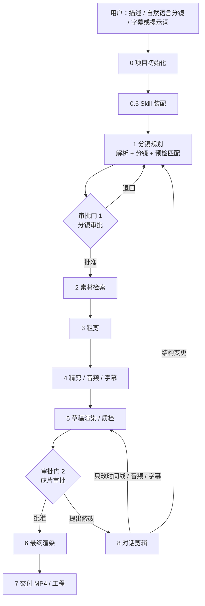

# AI 剪辑 Agent 应用设计方案

> 版本：设计稿 v3
>
> 本文只描述产品逻辑、Agent 架构、全流程、阶段职责、数据契约和接口边界，不指定技术栈、编程语言或页面布局实现。
>
> 不接知识库。规则、模板、风格、术语、案例和操作配方统一由 Skill 承载。
>
> 配套文件：
> - `AI剪辑Agent全流程图.drawio`
> - `Skill接入设计.md`
> - `Skill接入图.drawio`
> - `Agent架构与提示词.md`
> - `Agent架构图.drawio`
> - `Agent架构图.svg`

---

## 一、已确认的产品边界

| 项目 | 已确定内容 |
| --- | --- |
| 产品形态 | 仅做设计方案，不绑定技术栈和编程语言 |
| 核心能力 | 根据用户描述、自然语言分镜、向量素材库，自动完成分镜规划与剪辑 |
| 视觉素材 | 只来自已有向量素材库；素材为时间片段级，带完整元数据 |
| 素材检索 | 现有接口支持文字搜索和图片搜索；文字查询优先使用短词组 |
| 分镜输入 | 支持逐镜头自然语言描述、整段创作 brief、两者混合 |
| 输出画幅/时长 | 任意画幅、任意时长，由项目配置和分镜时间预算决定 |
| 配音 | 旁白由 TTS 自动生成 |
| 配乐 | 自动推荐，或由 AI 生成 |
| 字幕 | 用户提供字幕或提示词，AI 负责生成、润色与时间对齐 |
| 成片 | 直接导出 MP4，同时保留可继续编辑的工程；工程导出适配层已存在，本文不展开 |
| 对话剪辑 | 内置 Agent + 外部 ACP Agent；外部 Agent 只做对话剪辑 |
| Skill | 支持多种格式导入；替代知识库承载规则、模板、风格和案例 |
| 人工审批 | 只在分镜和成片两个节点审批 |
| 首版范围 | 单条片子端到端；不做批量、多版本、多人协作 |

---

## 二、产品定义

### 2.1 一句话定义

> 用户给出创作意图或自然语言分镜，系统从向量素材库中检索可用片段，自动规划镜头、组装时间线、生成旁白/配乐/字幕，产出一条可预览、可导出、可继续对话修改的成片。

### 2.2 核心闭环

```text
描述 / 分镜
   → Skill 装配
   → 分镜规划（含素材预检）
   → 分镜审批
   → 素材检索
   → 粗剪
   → 精剪 / 旁白 / 配乐 / 字幕
   → 草稿 / 质检
   → 成片审批
   → 导出 MP4 / 工程
   → 对话继续修改
```

### 2.3 两种工作模式

- **模式 A：自动成片**：用户只给主题、风格、时长、平台等 brief，系统生成分镜、检索素材、完成剪辑。
- **模式 B：按分镜成片**：用户提供逐镜头自然语言分镜，系统解析并规范化为结构分镜，再检索、装配和精剪。

两种模式汇合到同一份**分镜契约**。

---

## 三、总体架构

```text
交互层
  项目设置 / 分镜审批 / 时间线 / 对话 / 成片审批 / Skill 管理
        ↓
流程控制层（非 Agent）
  阶段状态机 / 两个审批门 / 版本 / 失败恢复 / 预算
        ↓
专业 Agent 层
  分镜 Agent / 素材检索 Agent / 剪辑 Agent
  音频字幕 Agent / 质检 Agent / 对话剪辑 Agent
        ↓
Skill 层
  Skill 注册表 / 路由与激活 / 渐进加载 / 权限与版本
        ↓
工具接口层
  向量素材库 / TTS / 配乐 / 字幕 / 渲染 / 工程导出 / ACP-MCP
        ↓
事实层
  项目 / 分镜 / 候选 / 时间线 / EDL / 审批 / 日志 / 版本
```

### 3.1 架构原则

1. **全局 Plan-Action**
   - 先形成分镜计划，再执行检索、装配、精剪和渲染。
   - 分镜是后续动作的上位约束。

2. **局部 ReAct**
   - 分镜与素材预检：生成镜头 → 检索 → 看覆盖 → 改镜头/查询。
   - 检索装配：搜索 → 看候选 → 换片段 → 重排。
   - 质检：发现问题 → 修复 → 复查。
   - 对话剪辑：读时间线 → 调工具 → 看结果 → 继续。

3. **决策与执行分离**
   - Agent 产出结构化剪辑决策。
   - 渲染器只执行，不自由发挥。

4. **素材有据可查**
   - 每个入选片段保留查询、候选排名、元数据、入出点和选择理由。
   - 视觉素材不允许绕开素材库。

5. **对话修改可控**
   - 直接应用 + 每轮撤销快照 + 锁定对象硬约束。
   - 外部 Agent 只能通过受控 MCP 工具修改。

6. **没有制片人 Agent**
   - 原制片人的职责由确定性流程控制器承担。
   - 流程控制器不是 LLM Agent，只执行状态机、审批门、版本和失败恢复规则。

---

## 四、Agent 角色

| 角色 | 职责 | 主要产物 |
| --- | --- | --- |
| 流程控制器（非 Agent） | 阶段状态、审批门、版本、预算、失败恢复 | 阶段状态、审批记录、运行日志 |
| 分镜 Agent | 解析输入、生成分镜、生成素材查询、预检匹配、修订分镜 | 分镜、镜头需求、覆盖报告 |
| 素材检索 Agent | 预检检索、正式检索、过滤、重排、候选选择 | 候选集、选择理由、检索证据 |
| 剪辑 Agent | 选片、入出点、时间线、转场、EDL | 时间线、EDL |
| 音频字幕 Agent | TTS 旁白、配乐、字幕、混音 | 音频计划、字幕计划 |
| 质检 Agent | 技术/编辑/合规/Skill 一致性检查与修复建议 | 质检报告、修复操作 |
| 对话剪辑 Agent | 理解修改意图，调用时间线工具 | 修改操作、回复、快照 |
| 外部 ACP Agent | 通过 MCP 工具参与对话剪辑 | 工具调用、修改说明 |
| Skill 管理服务（非 LLM Agent） | 导入、路由、渐进加载、权限、版本 | SkillContext、激活清单、版本锁 |

各 Agent 的提示词、输入输出和协作关系见 `Agent架构与提示词.md`。

---

## 五、全流程与阶段



### 阶段 0：项目初始化

**输入**

- 项目名称；
- 画幅（任意宽高比）；
- 目标时长（可固定，也可由系统建议）；
- 帧率、输出规格；
- 素材库连接信息；
- 可选参考图/参考片；
- 可选字幕、台词稿、提示词；
- 可选 Skill。

**动作**

- 建立项目事实空间；
- 检查素材库可用性、索引版本、元数据完整性；
- 检查 TTS、配乐、渲染、工程导出能力；
- 建立初始版本和运行日志。

**输出**

- 项目配置；
- 能力清单；
- 素材库健康报告。

---

### 阶段 0.5：Skill 装配

**输入**

- 项目配置；
- 用户 brief 或分镜；
- 可用 Skill 清单与权限。

**动作**

- 按“Skill 接入设计”路由适用 Skill；
- 先读元数据，再按需加载完整说明和资源；
- 装配品牌、平台、叙事、镜头、剪辑、字幕、配乐、合规等能力；
- 处理冲突：项目 Skill > 用户 Skill > 官方 Skill > 内置默认；
- 记录激活清单、权限、版本锁和缺口。

**输出**

- `SkillContext`；
- 激活清单；
- 权限与版本锁；
- `Conflicts` / `Gaps`。

---

### 阶段 1：分镜规划（输入解析 + 分镜 + 预检匹配）

这是本方案的核心阶段。分镜 Agent 同时承担输入解析和分镜生成，并在分镜审批前与素材检索 Agent 做预检匹配。

**输入**

- 用户描述；
- 自然语言分镜；
- `SkillContext`；
- 素材库能力概况（时长、画幅、标签、版权等）；
- 参考图/参考片。

**动作**

1. **输入解析**
   - 逐镜模式：按编号、段落、场景标题切分，提取画面、动作、台词、时长、情绪；
   - brief 模式：提取主题、受众、平台、风格、总时长、必含/排除项；
   - 混合模式：优先保留镜头结构，缺失字段由 brief 补；
   - 输出 `Brief`、`StoryboardDraft`、术语表、约束、缺失项、显式假设。

2. **分镜生成**
   - 建立叙事结构：开场、发展、转折、落点；
   - 拆分场景与镜头；
   - 每镜写：目的、画面、主体/动作、景别、机位、运动、时长、情绪、转场、旁白、字幕；
   - 为每镜生成素材需求与 2–4 组短词组查询；
   - 计算时间预算；
   - 生成旁白、字幕、配乐方向草案。

3. **预检匹配循环**
   - 素材检索 Agent 对每个镜头做低成本预检（只检索，不生成、不下载、不剪辑）；
   - 返回候选数、最高匹配、时长/画幅/版权是否满足、缺口；
   - 分镜 Agent 根据覆盖报告修订镜头或查询：
     - 改动作/场景/景别；
     - 拆分或合并镜头；
     - 换短词组；
     - 放宽查询条件；
   - 最多 3 轮；仍不达标则标记缺口，带到分镜审批页。

4. **输出分镜**
   - 分镜、镜头需求、时间预算、覆盖报告、假设和风险。

**输出**

- `Brief`；
- `Storyboard`；
- `MaterialPlan`：每镜短词组、图像参考、硬过滤条件；
- `CoverageReport`；
- `Assumptions` / `Risks`。

---

### 审批门 1：分镜审批

**审批内容**

- 场景/镜头列表；
- 每镜目的、画面、时长、旁白、字幕；
- 总时长与画幅；
- 素材覆盖报告；
- 每镜短词组查询和候选概况；
- 旁白语气、配乐方向；
- 字幕来源与语言；
- 预计成本；
- 已知缺口和风险。

**用户可做**

- 修改镜头文字、顺序、时长；
- 增删镜头；
- 调整总时长/画幅；
- 替换旁白/字幕策略；
- 查看覆盖报告，接受或修改缺口；
- 批准，或退回重规划。

**批准后**

- 分镜 v1 锁定；
- 进入正式素材检索；
- 后续结构性修改必须重新回到此门。

---

### 阶段 2：素材检索

**输入**

- 已批准分镜；
- `MaterialPlan`；
- 素材库文本/图像搜索接口；
- `SkillContext`。

**动作**

1. 将每镜短词组、可选图像参考、硬过滤条件送入检索。
2. 文本/图像双通道召回。
3. 排名融合；有可比分数时加权，否则用排名融合。
4. 硬过滤：时长、画幅、版权、画质、语言、禁用元素。
5. 重排：语义、时长、运动、景别、连续性、重复惩罚。
6. 每镜保留 8–12 个候选，做多样性选择。
7. 记录检索证据。
8. 首选片段不可用时使用备选；仍无则报缺口。

**输出**

- `CandidateSet`；
- `SelectedClips`；
- `RetrievalEvidence`；
- `Gaps`。

---

### 阶段 3：粗剪

**输入**

- `Storyboard`；
- `CandidateSet`；
- `SkillContext`；
- 时间预算。

**动作**

- 每镜选首选片段；
- 计算入出点，保留动作起势/收势；
- 主轨不重叠；
- 设计转场；
- 放置旁白/字幕/配乐占位；
- 生成 EDL。

**输出**

- `Timeline`；
- `EDL`；
- `SelectionReasons`；
- `Risks`。

---

### 阶段 4：精剪、旁白、配乐、字幕

**输入**

- 粗剪时间线；
- 分镜旁白/字幕草案；
- 用户字幕/提示词；
- `SkillContext`。

**动作**

1. **旁白**：TTS 生成；控制语速、停顿、情绪；保留词级/句级时间。
2. **配乐**：按情绪、节奏、时长推荐；无合适曲目时生成；配置淡入淡出、ducking。
3. **原声**：决定保留、降低或静音片段原声；保证叙事清晰。
4. **字幕**：用户字幕直接对齐；用户只给提示词则生成、润色、断句、对齐；处理安全区和双语。
5. **节奏修正**：检查镜头过短/过长、旁白错位、转场过密；必要时回到粗剪换片段或微调。

**输出**

- `Timeline` 精剪版；
- `AudioPlan`；
- `SubtitlePlan`；
- `EDL` 更新版。

---

### 阶段 5：草稿渲染与自动质检

**动作**

1. 渲染低分辨率草稿。
2. 技术检查：时长、黑帧、空轨、素材缺失、音频削波、字幕出框、画幅/帧率。
3. 编辑检查：镜头覆盖分镜、旁白对齐、节奏、重复素材、开头钩子、结尾落点。
4. 合规/Skill 检查：品牌禁用项、平台规则、版权、字幕可读性。
5. 自动修复：换备选、调入出点、修正字幕、调 ducking、重排镜头。
6. 最多两轮；仍有问题记录为已知风险。

**输出**

- 草稿视频；
- `QCReport`；
- `RenderReport` 草稿版。

---

### 审批门 2：成片审批

**审批内容**

- 完整草稿预览；
- 时间线与镜头列表；
- 旁白、配乐、字幕；
- 素材清单与版权/来源；
- 质检报告；
- 总时长、画幅、输出规格；
- 已知风险。

**用户可做**

- 批准 → 最终渲染/导出；
- 在对话里提出修改 → 对话剪辑；
- 结构性修改分镜 → 回到审批门 1；
- 只改时间线/音频/字幕 → 修改后重新草稿渲染，再回本门。

**批准后**

- 锁定成片版本；
- 最终渲染；
- 导出 MP4 和工程。

---

### 阶段 6：最终渲染

- 按最终画幅/帧率/码率渲染；
- 输出 MP4；
- 生成工程快照，交给既有工程导出适配层；
- 写入渲染报告、素材清单、审批记录；
- 归档版本。

**输出**

- 最终 MP4；
- 工程快照/导出请求；
- `RenderReport`；
- `DeliveryManifest`。

---

### 阶段 7：交付

- 交付 MP4；
- 交付工程快照；
- 归档版本、审批、日志、素材清单。

---

### 阶段 8：对话剪辑

**输入**

- 当前时间线；
- 分镜；
- 用户选中的片段/时刻/范围；
- 用户自然语言指令；
- `SkillContext`；
- 外部 ACP Agent（可选）。

**动作**

1. 解析意图：改画面、节奏、素材、旁白、字幕、音乐、转场。
2. 读取时间线、锁定状态、项目决策 Skill。
3. 调用工具执行修改。
4. 刷新预览。
5. 回复用户，列出本轮改动。
6. 保留撤销快照和操作日志。

**结构变更规则**

- 只改时间线/音频/字幕：不重新审批分镜；
- 改镜头数量、顺序、叙事：回到审批门 1；
- 改画幅/总时长：回到审批门 1。

---

## 六、分镜 Agent 如何确保与现有素材匹配

这是本方案的重点问题。结论：**不能等分镜审批后再检索；必须在分镜阶段做“检索约束的分镜规划”。**

### 6.1 核心机制

```text
生成镜头意图
  → 生成 2–4 组短词组 + 可选图像参考
  → 素材检索 Agent 预检
  → 看覆盖：候选数 / 最高分 / 时长 / 画幅 / 版权
  → 不达标就改镜头或改查询
  → 最多 3 轮
  → 带覆盖报告进入分镜审批
```

分镜 Agent 不直接假设“素材库一定有”，而是把每个镜头写成**可检索的镜头需求**：

```text
ShotMaterialPlan
  shot_id
  short_queries: 2–4 组短词组
  image_query: 可选参考图
  must_terms
  avoid_terms
  min_duration
  aspect
  rights
  quality
  fallback: 备选镜头/备选查询
```

### 6.2 短词组查询规范

文字查询优先使用短词组，而不是长句：

- 2–6 个词；
- 主体 + 动作；
- 场景 + 主体；
- 景别 + 动作；
- 每组 2–4 个变体；
- 必含词和排除词分开。

示例：

```text
镜头：雨夜，女子推开便利店玻璃门，近景
查询：
  1. 女子 推开 玻璃门
  2. 雨夜 便利店 门口
  3. 手 推门 特写
排除：动画、室内白天、多人
过滤：时长 ≥ 3.2 秒、横屏、版权可用、画质达标
```

为什么用短词组：

- 文本嵌入对短而具体的描述更稳定；
- 关键词检索对品牌、物体、动作更精确；
- 长句会引入无关语义，降低召回质量；
- 多组短词组比一条长句更容易做融合和重排。

### 6.3 覆盖评估

预检返回每镜：

- 候选数量；
- 最高匹配分/排名；
- 满足时长、画幅、版权、画质的候选数；
- 候选多样性；
- 是否只能靠放宽条件才能找到。

通过标准示例：

- 100% 镜头至少有 1 个合法候选；
- ≥ 80% 镜头有 ≥ 3 个高于阈值的候选；
- 没有镜头在放宽条件前完全无结果；
- 高风险缺口在审批页明确展示。

### 6.4 不达标时的修订顺序

1. 换短词组/同义词；
2. 加/减必含词和排除词；
3. 调整镜头动作、场景、景别；
4. 拆分/合并镜头；
5. 放宽时长/画幅/版权条件；
6. 仍无结果：标记缺口，带到分镜审批页，由用户决定接受或改分镜。

不允许用素材库以外的视觉素材补洞。

### 6.5 对素材库黑箱的改进建议

现有接口是文字或图片检索。为了支持上面的预检闭环，建议把黑箱接口升级为：

```text
search(
  text: string[],             // 2–4 组短词组
  image?: bytes,              // 可选参考图
  clip_id?: string,           // 可选：以片段找相似
  filters: {
    duration_min, duration_max,
    aspect, orientation,
    rights, quality_min,
    tags, exclude_tags,
    language
  },
  top_k: number,
  mode: "preflight" | "full"
) -> {
  clip_id, score, rank, in, out, duration,
  aspect, rights, tags, caption,
  keyframe, shot_size, motion,
  thumbnail, index_version
}[]
```

建议增加：

| 接口 | 作用 | 为什么需要 |
| --- | --- | --- |
| `batch_search(queries[])` | 一次查多个镜头/多组短词组 | 预检要跑很多查询，逐条调用太慢 |
| `coverage(query, filters)` | 返回候选数量/可用数量 | 分镜阶段需要判断“够不够剪” |
| `similar(clip_id)` | 找视觉相似片段 | 保持镜头连续性、找备选 |
| `facets()` | 返回标签、时长、画幅、版权分布 | 让分镜知道素材库大致能覆盖什么 |
| `get_clip(clip_id)` | 返回完整片段时间片段元数据 | 正式装配需要入出点和版权 |
| `health()` / `index_version` | 返回索引版本和可用性 | 保证可复现和故障定位 |

接口返回最好同时给**分数和排名**：

- 分数可比时做加权融合；
- 分数不可比时用排名融合；
- 多组短词组之间用排名融合，避免某一路分数偏高。

### 6.6 参考来源

| 来源 | 参考点 |
| --- | --- |
| Radford et al., 2021, CLIP | 文本/图像共享嵌入，短文本与画面语义对齐 |
| Luo et al., 2022, CLIP4Clip | CLIP 用于视频片段检索，文本到片段的匹配 |
| Xu et al., 2021, VideoCLIP | 视频-文本对比学习，零样本视频检索 |
| Lei et al., 2021, Moment-DETR | 自然语言定位视频时间段，支持“描述→片段” |
| Robertson & Zaragoza, 2009, BM25 | 短词组、专有名词、品牌名的精确检索 |
| Cormack et al., 2009, RRF | 多路检索排名融合，不依赖分数可比 |
| Carbonell & Goldstein, 1998, MMR | 候选多样性，避免连续镜头重复 |
| Yao et al., 2023, ReAct | 推理—行动—观察循环，用于预检修订 |
| Madaan et al., 2023, Self-Refine | 生成—反馈—修订，用于分镜覆盖不足时的迭代 |

完整引用：

- Radford, A., et al. “Learning Transferable Visual Models From Natural Language Supervision.” ICML 2021.
- Luo, H., et al. “CLIP4Clip: An Empirical Study of CLIP for End to End Video Clip Retrieval.” Neurocomputing 2022.
- Xu, H., et al. “VideoCLIP: Contrastive Pre-training for Zero-shot Video-Text Understanding.” EMNLP 2021.
- Lei, J., et al. “Moment-DETR: Localizing Moments in Video with Natural Language.” ICCV 2021.
- Robertson, S., and Zaragoza, H. “The Probabilistic Relevance Framework: BM25 and Beyond.” Foundations and Trends in Information Retrieval, 2009.
- Cormack, G. V., et al. “Reciprocal Rank Fusion Outperforms Condorcet and Individual Rank Learning Methods.” SIGIR 2009.
- Carbonell, J., and Goldstein, J. “The Use of MMR, Diversity-Based Reranking for Reordering Documents and Producing Summaries.” SIGIR 1998.
- Yao, S., et al. “ReAct: Synergizing Reasoning and Acting in Language Models.” ICLR 2023.
- Madaan, A., et al. “Self-Refine: Iterative Refinement with Self-Feedback.” NeurIPS 2023.

说明：短词组优先、预检覆盖阈值和“生成→检索→回改”的具体组合，是基于上述方法的设计综合，不是某篇论文的直接结论；阈值和查询模板需要按素材库的实际分布调优。

---

## 七、素材检索设计

### 7.1 双通道召回

- 文本：每镜 2–4 组短词组；
- 图像：用户参考图，或已确认参考帧；
- 没有图像时只走文本。

### 7.2 融合与过滤

```text
文本召回 + 图像召回
  → 排名融合
  → 硬过滤：时长/画幅/版权/画质/语言/禁用元素
  → 重排：语义/时长/运动/景别/连续性/重复惩罚
  → 多样性：MMR
  → 候选集
```

### 7.3 候选与选择

- 每镜保留 8–12 个候选；
- 首选 1 个，备选 2–3 个；
- 每个候选带检索证据；
- 首选不可用时按备选顺序替换。

### 7.4 检索失败

按顺序放宽：查询词 → 必含/排除 → 时长/画幅 → 版权/画质 → 标记缺口。

不允许用素材库以外的视觉素材补洞。

---

## 八、核心数据契约

### 8.1 项目

```text
Project
  id, title
  config: 画幅、宽高、帧率、目标时长、输出规格
  library: 素材库引用、索引版本
  style: 视觉/旁白/字幕/音乐偏好
  status: 状态机状态
  versions: 分镜版本、时间线版本、渲染版本
  approvals: 分镜审批、成片审批
```

### 8.2 分镜

```text
Storyboard
  scenes[]
    id, title, purpose, duration
    shots[]
      id, order, duration
      purpose
      visual, action
      shotSize, camera, mood
      transition
      narration, subtitle
      material_plan: 短词组、参考图、过滤条件
      coverage: 预检结果
```

### 8.3 时间线与 EDL

```text
Timeline
  tracks[]
    id, kind, locked, hidden, muted
    clips[]
      id, sourceClipId
      at, inPoint, outPoint, duration
      speed, volume, layer, transform
      transitionIn/Out, locked
  audio: 旁白、配乐、原声、ducking
  subtitles: 文本、时间、样式
```

---

## 九、自动剪辑逻辑

- 每镜首选候选 + 备选；
- 入出点保留动作起势/收势；
- 主轨不重叠，锁定不可改；
- 转场服务叙事；
- 旁白、字幕、配乐先占位；
- 生成 EDL，记录选择理由和风险；
- 镜头过短/过长时合并、拆分或换片段。

---

## 十、对话剪辑

### 10.1 两种 Agent 共用一套工具

- 内置对话剪辑 Agent；
- 外部 ACP Agent（Claude Code/Codex/OpenCode 等）。

两者都只通过受控工具操作项目，不直接写项目文件。

### 10.2 外部 ACP 边界

- 可读项目、分镜、时间线、候选素材；
- 可调用时间线编辑工具；
- 可请求预览；
- 不可启动自动流水线；
- 不可安装/修改 Skill；
- 不可最终导出；
- 不可删除项目；
- 不可绕过锁定和版本校验。

### 10.3 工具面

- 读取项目/分镜/时间线/选中片段；
- 搜索素材；
- 添加/删除/移动/裁剪/分割片段；
- 设置速度/音量/转场；
- 编辑字幕/旁白/配乐；
- 锁定/解锁；
- 渲染预览；
- 创建撤销快照。

### 10.4 直接修改 + 撤销 + 锁定

- 每轮开始前创建快照；
- 修改直接应用；
- 用户可逐轮撤销；
- 锁定对象硬拒绝；
- 携带基线版本；冲突时重新读取，不静默覆盖。

### 10.5 结构变更

- 只改时间线/音频/字幕：不重新审批分镜；
- 改镜头数量、顺序、叙事、画幅、总时长：回到分镜审批门。

---

## 十一、Skill 体系

本应用不接知识库。规则、模板、风格、术语、案例和操作配方由 Skill 承载。

- 支持多种格式：`SKILL.md`、项目 Skill、自定义清单、通用文件夹；
- 注册、路由、渐进加载、权限、版本锁；
- 数量不限、类型不限；
- 优先级：项目 Skill > 用户 Skill > 官方 Skill > 内置默认；
- Skill 只提供说明、资源、策略，不直接改项目；
- 含脚本的 Skill 默认不执行，需显式授权。

详细接入点、类型、参考依据见 `Skill接入设计.md`。

---

## 十二、质检与失败恢复

**技术**：时长、黑帧、空轨、素材缺失、音频削波、字幕出框、画幅/帧率。

**编辑**：镜头覆盖分镜、旁白对齐、节奏、重复素材、开头钩子、结尾落点。

**合规/Skill**：品牌禁用项、平台规则、版权、字幕可读性、Skill 一致性。

**修复**：换备选、调入出点、重排、调旁白/配乐/ducking、修字幕；最多两轮；仍失败记录为已知风险。

---

## 十三、状态机与版本

```text
INIT
 → SKILL_ASSEMBLY
 → STORYBOARD_PLANNING
 → AWAIT_STORYBOARD_APPROVAL
 → RETRIEVAL
 → ROUGH_CUT
 → FINE_CUT
 → DRAFT_RENDER
 → QC
 → AWAIT_FINAL_APPROVAL
 → FINAL_RENDER
 → DELIVERED
```

旁路：`CHAT_EDIT`、`BLOCKED`、`FAILED`、`REVISION`。

- 只有两个等待人工的状态：分镜审批、成片审批；
- 失败保留已完成产物；
- 结构变更回分镜；
- 时间线修改回草稿渲染；
- 版本、审批、日志可回放。

---

## 十四、非目标

- 批量/多版本；
- 多人协作；
- 素材库管理后台；
- 视觉素材生成；
- 外部 NLE 插件；
- 外部 Agent 直接改项目文件；
- 绕过人工审批的全自动交付。

---

## 十五、验收标准

- 分镜 Agent 能解析逐镜/brief/混合输入；
- 分镜阶段完成预检匹配，覆盖报告可见；
- 分镜审批前能发现缺口；
- 素材查询以短词组为主，支持文字/图片；
- 素材库黑箱支持过滤、批量、覆盖、相似、元数据；
- 分镜审批后才能正式检索；
- 粗剪/精剪/音频字幕/质检能自动完成；
- 对话剪辑支持直接改、撤销、锁定、冲突检测；
- 外部 ACP 只做对话剪辑；
- Skill 多格式导入并生效；
- 只保留两个人工审批门；
- 能导出 MP4 和工程快照。

---

## 十六、交付物

```text
AI剪辑Agent设计方案/
  AI剪辑Agent设计方案.md
  AI剪辑Agent全流程图.drawio
  Skill接入设计.md
  Skill接入图.drawio
  Agent架构与提示词.md
  Agent架构图.drawio
  Agent架构图.svg
```

工程导出适配层已存在，本文只定义导出触发、工程快照和交付清单，不重复设计其内部实现。
