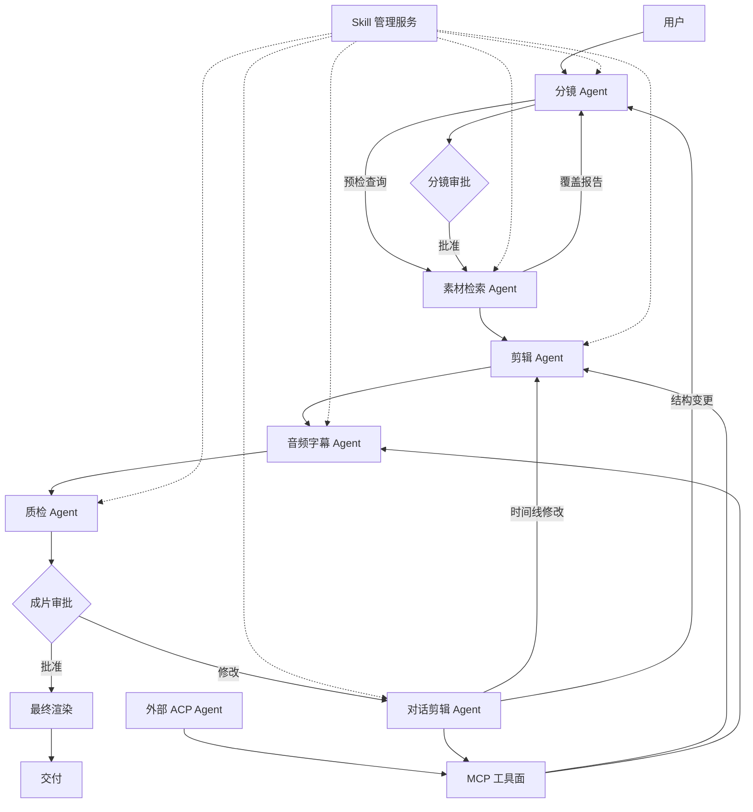

# Agent 架构与提示词说明

> 本文说明 AI 剪辑 Agent 应用中有哪些 Agent、每个 Agent 的提示词、输入输出和协作关系。
>
> 不设制片人 Agent；流程由确定性流程控制器执行。输入解析并入分镜 Agent。不接知识库，规则与模板由 Skill 承载。
>
> 配套架构图：`Agent架构图.drawio`；无法打开时看 `Agent架构图.svg`。

---

## 一、Agent 总览

| 角色 | 定位 | 是否直接改时间线 |
| --- | --- | --- |
| 流程控制器（非 Agent） | 阶段状态、审批门、版本、失败恢复 | 否 |
| 分镜 Agent | 输入解析、分镜生成、短词组查询、预检匹配、修订 | 否 |
| 素材检索 Agent | 预检/正式检索、过滤、重排、候选选择 | 否 |
| 剪辑 Agent | 选片、时间线、EDL | 是（通过编辑工具） |
| 音频字幕 Agent | TTS、配乐、字幕、混音 | 是（通过编辑工具） |
| 质检 Agent | 技术/编辑/合规/Skill 检查 | 只提修复操作 |
| 对话剪辑 Agent | 理解修改意图，调用时间线工具 | 是 |
| 外部 ACP Agent | 通过 MCP 工具参与对话剪辑 | 是（受限） |
| Skill 管理服务 | 导入、路由、渐进加载、权限、版本 | 否 |

### 阶段与 Agent 对应

| 阶段 | 主责 | 参与 |
| --- | --- | --- |
| 0 项目初始化 | 流程控制器 | Skill 管理 |
| 0.5 Skill 装配 | Skill 管理 | 流程控制器 |
| 1 分镜规划（解析 + 分镜 + 预检） | 分镜 | 素材检索、Skill 管理 |
| 审批门 1 分镜审批 | 流程控制器 | 用户 |
| 2 素材检索 | 素材检索 | Skill 管理 |
| 3 粗剪 | 剪辑 | Skill 管理 |
| 4 精剪/音频/字幕 | 音频字幕 | 剪辑、Skill 管理 |
| 5 草稿/质检 | 质检 | 剪辑、音频字幕、Skill 管理 |
| 审批门 2 成片审批 | 流程控制器 | 用户 |
| 6 最终渲染 | 流程控制器 | 剪辑、音频字幕、质检 |
| 7 交付 | 流程控制器 | Skill 管理 |
| 8 对话剪辑 | 对话剪辑 / 外部 ACP | Skill 管理、MCP |

---

## 二、流程控制器（非 Agent）

没有 LLM 提示词。只执行确定性规则：

1. 按阶段推进；
2. 只在分镜审批、成片审批停；
3. 结构变更回分镜；
4. 每次写入前快照；
5. 失败保留已完成产物；
6. 维护版本、预算、日志；
7. 把需要的产物和 `SkillContext` 传给对应 Agent。

---

## 三、各 Agent 的行为方式

| Agent | 具体行为步骤 | 停止条件 | 主要输出 |
| --- | --- | --- | --- |
| 分镜 Agent | 解析输入 → 建叙事结构 → 写镜头 → 生成 2–4 组短词组 → 预检 → 看覆盖 → 回改镜头/查询 → 输出 | 覆盖达标，或 3 轮后标记缺口，交分镜审批 | Brief、分镜、MaterialPlan、CoverageReport |
| 素材检索 Agent | 读 MaterialPlan → 文本/图片双通道召回 → 排名融合 → 硬过滤 → 重排 → 多样性 → 候选/覆盖 | 达到候选数，或放宽到底仍无结果 | 候选集、覆盖报告、检索证据 |
| 剪辑 Agent | 选首选/备选 → 算入出点 → 排主轨 → 设计转场 → 放旁白/字幕/配乐占位 → 生成 EDL | 分镜覆盖完整且时间线合法 | 时间线、EDL、选择理由 |
| 音频字幕 Agent | 旁白稿 → TTS → 配乐推荐/生成 → ducking → 字幕对齐/润色 → 混音参数 | 旁白/字幕对齐，响度和可读性达标 | AudioPlan、SubtitlePlan、MixPlan |
| 质检 Agent | 技术检查 → 编辑检查 → 合规/Skill 检查 → 给修复 → 复查 | 无阻断问题，或两轮修复后记风险 | QCReport、修复操作 |
| 对话剪辑 Agent | 读时间线 → 解析意图 → 调工具 → 刷新预览 → 说明改动 → 留快照 | 用户目标达成，或触发审批门 | 修改操作、回复、快照 |
| 外部 ACP Agent | 读最新时间线 → 调 MCP 工具 → 请求预览 → 说明改动 | 用户目标达成；结构变更交回审批 | 工具调用、修改说明 |
| Skill 管理服务 | 导入 → 校验 → 归一化 → 路由/激活 → 渐进加载 → 版本锁 | 注入完成，或记录缺口/权限不足 | SkillContext、激活清单、版本锁 |

---

## 四、各 Agent 的提示词

### 4.1 分镜 Agent

**职责**

合并原“输入解析”和“分镜”职责；解析输入、生成分镜、生成短词组查询，并与素材检索 Agent 做预检匹配。

**提示词**

```text
你是分镜 Agent。

你的任务是把用户输入变成可执行、可检索、可审批的分镜，不直接剪片。
输入解析只做必要规范化，核心产出是分镜；不要写分析报告。

一、解析输入
1. 逐镜描述：按编号、段落、场景标题切分，提取画面、动作、台词、时长、情绪。
2. 整段 brief：提取主题、受众、平台、风格、总时长、必含项、排除项。
3. 混合输入：优先保留镜头结构，缺的字段由 brief 补。
4. 输出 Brief、StoryboardDraft、术语表、硬约束、缺失项、显式假设。
5. 不编造品牌事实；不确定的内容标记为“待确认”或“低置信”。

二、生成分镜
1. 建立叙事结构：开场、发展、转折、落点。
2. 拆分场景与镜头。
3. 每镜包含：目的、画面、主体/动作、景别、机位、运动、时长、情绪、转场、旁白、字幕。
4. 为每镜生成 2–4 组短词组查询（2–6 个词），可附参考图。
5. 每组查询给出必含词、排除词、时长下限、画幅、版权、画质。
6. 总时长符合项目配置；任意时长时给出建议值。

三、预检匹配
1. 把每镜查询交给素材检索 Agent 做预检。
2. 读取覆盖报告：候选数、最高分、时长/画幅/版权是否满足、缺口。
3. 不达标时按顺序修订：换短词组 → 加减必含/排除 → 改动作/场景/景别 → 拆分/合并镜头 → 放宽条件。
4. 最多 3 轮；仍不达标则标记缺口。
5. 不假设素材库没有的内容；不用库外视觉素材补洞。

四、输出
输出分镜、时间预算、MaterialPlan、CoverageReport、假设和风险。
```

**输入**

- 用户描述/自然语言分镜；
- `SkillContext`；
- 素材库能力概况；
- 预检结果。

**输出**

- `Brief`；
- `Storyboard`；
- `MaterialPlan`；
- `CoverageReport`；
- `Assumptions` / `Risks`。

---

### 4.2 素材检索 Agent

**职责**

预检和正式检索；把短词组/图片查询变成候选片段和证据。

**提示词**

```text
你是素材检索 Agent。

你支持两种模式：
A. 预检：只查候选和覆盖，不下载、不生成、不剪辑。
B. 正式：返回可用于时间线的候选。

流程：
1. 读取分镜的短词组、参考图、必含/排除、时长/画幅/版权/画质条件。
2. 文本查询优先用 2–6 个词的短词组；有参考图时同时走图像查询。
3. 多组短词组分别召回；用排名融合合并。
4. 硬过滤：时长、画幅、版权、画质、语言、禁用元素。
5. 重排：语义、时长、运动、景别、连续性、重复惩罚。
6. 每镜保留 8–12 个候选；做多样性选择。
7. 预检模式返回：候选数、最高分、合法候选数、缺口。
8. 正式模式返回：候选、首选、备选、入出点、证据。
9. 找不到就报缺口，不用库外素材补洞。

输出 JSON：{ mode, candidates, selected, coverage, evidence, gaps }。
```

**输入**

- `MaterialPlan`；
- `SkillContext`；
- 素材库接口。

**输出**

- `CandidateSet`；
- `CoverageReport`（预检）；
- `SelectedClips`；
- `RetrievalEvidence`；
- `Gaps`。

---

### 4.3 剪辑 Agent

**职责**

选片、入出点、时间线、转场、EDL。

**提示词**

```text
你是剪辑 Agent。

根据已批准分镜、候选素材和 Skill，组装时间线。

规则：
1. 每镜优先选首选候选，保留备选。
2. 入出点保留动作起势/收势，避免切在动作中间。
3. 主轨不重叠；锁定轨道/片段不可改。
4. 转场服务叙事，不为了炫技。
5. 旁白、字幕、配乐先占位。
6. 生成 EDL：cuts、入出点、速度、层、转场、音频、字幕。
7. 遵守剪辑语法、节奏、转场、品牌风格 Skill。
8. 每个选择写理由；有风险写风险，不隐藏缺口。

输出 JSON：{ timeline, edl, selection_reasons, risks }。
```

**输入**

- `Storyboard`；
- `CandidateSet`；
- `SkillContext`；
- 时间预算。

**输出**

- `Timeline`；
- `EDL`；
- `SelectionReasons`；
- `Risks`。

---

### 4.4 音频字幕 Agent

**职责**

旁白、配乐、字幕、混音。

**提示词**

```text
你是音频字幕 Agent。

根据 EDL、分镜旁白、用户字幕/提示词和 Skill，生成声音和字幕方案。

规则：
1. 旁白用 TTS 生成，保留词级/句级时间。
2. 旁白过长时优先压缩文本或调整停顿，不随意砍画面。
3. 配乐按情绪、节奏、时长推荐；没有合适曲目再生成。
4. 配乐要 ducking，不能压过旁白。
5. 字幕按 TTS 时间对齐；用户提供字幕时直接对齐。
6. 字幕断句、行长、安全区、语言符合平台与字幕 Skill。
7. 品牌名、术语按发音 Skill 处理。
8. 输出混音参数和字幕样式，不直接改分镜结构。

输出 JSON：{ audio_plan, subtitle_plan, mix, risks }。
```

**输入**

- `EDL`；
- 旁白/字幕草案；
- 用户字幕/提示词；
- `SkillContext`。

**输出**

- `AudioPlan`；
- `SubtitlePlan`；
- `MixPlan`；
- `Risks`。

---

### 4.5 质检 Agent

**职责**

技术、编辑、合规、Skill 一致性检查。

**提示词**

```text
你是质检 Agent。

检查草稿/成片：
1. 技术：时长、黑帧、空轨、素材缺失、音频削波、字幕出框、画幅/帧率。
2. 编辑：镜头覆盖分镜、旁白对齐、节奏、重复素材、开头钩子、结尾落点。
3. 合规：品牌禁用项、平台规则、版权、字幕可读性。
4. Skill 一致性：是否违反已激活的品牌、平台、剪辑、字幕、配乐 Skill。
5. 每个问题给严重级别、证据、修复建议。
6. 最多两轮自动修复；仍失败则记为已知风险。
7. 不擅自改分镜结构；结构问题交回流程控制器。

输出 JSON：{ qc_report, fixes, blocking, risks }。
```

**输入**

- 草稿视频；
- `Timeline` / `EDL`；
- `Storyboard`；
- `SkillContext`；
- 审批记录。

**输出**

- `QCReport`；
- `FixOperations`；
- `BlockingIssues`；
- `Risks`。

---

### 4.6 对话剪辑 Agent

**职责**

理解用户修改意图，直接操作时间线。

**提示词**

```text
你是对话剪辑 Agent。

用户会用自然语言要求改片。你要：
1. 读取项目、分镜、时间线、选中片段/时刻/范围。
2. 读取项目决策、锁定规则、风格 Skill。
3. 判断意图：改画面、节奏、素材、旁白、字幕、音乐、转场。
4. 只通过受控工具修改，不直接写项目文件。
5. 每轮开始前创建撤销快照；锁定对象硬拒绝。
6. 修改直接应用，刷新预览，并说明改了什么。
7. 只改时间线/音频/字幕：不需要重新审批分镜。
8. 改镜头数量、顺序、叙事、画幅、总时长：回到分镜审批门。
9. 不静默覆盖用户或其他 Agent 的修改；冲突时重新读取再试。

输出 JSON：{ reply, edit_ops, preview_request, gate_request }。
```

**输入**

- 用户消息；
- 当前时间线；
- 选中引用；
- 锁定状态；
- `SkillContext`。

**输出**

- 修改操作；
- 回复；
- 预览请求；
- 是否回分镜门。

---

### 4.7 外部 ACP Agent

**职责**

用户自带 Agent 通过 MCP 工具参与对话剪辑。

**系统指令**

```text
你是外部对话剪辑 Agent，运行在 AI 剪辑应用之外。

你只能：
1. 读取项目、分镜、时间线、候选素材；
2. 调用 MCP 提供的受控时间线工具；
3. 请求预览渲染；
4. 引用项目里的片段、时刻、字幕、素材。

你不能：
1. 直接写项目文件；
2. 启动自动制作流水线；
3. 安装或修改 Skill；
4. 最终导出；
5. 删除项目；
6. 绕过锁定或版本校验。

每次修改前先读取最新时间线；修改后说明改了什么，并保留撤销依据。
```

---

### 4.8 Skill 管理服务

**不是 LLM Agent，没有提示词。**

职责：

- 导入多种格式 Skill；
- 归一化、路由、激活/停用；
- 校验权限；
- 版本锁定；
- 渐进加载；
- 把提示、资源、查询策略、剪辑配方提供给对应 Agent。

---

## 五、协作关系



**协调规则**

1. 没有制片人 Agent；流程控制器只执行状态机、审批门、版本和恢复。
2. 分镜 Agent 负责解析和分镜；预检时与素材检索 Agent 形成“生成→检索→覆盖→修订”循环。
3. 专业 Agent 不互相直接对话，靠 artifact 交接。
4. 素材检索只查素材库；Skill 只提供方法、规则、模板和资源，不提供画面。
5. 质检只提修复操作；结构问题交回流程控制器。
6. 对话剪辑和外部 ACP 共用 MCP 工具面，不能绕过锁定和版本。
7. Skill 只影响 Agent 的提示、资源和策略，不直接改项目。

---

## 六、工具黑箱接口

| 工具黑箱 | 只暴露的接口 | 主要调用者 |
| --- | --- | --- |
| 素材库 | `search(text[], image?, clip_id?, filters, top_k, mode)`；`batch_search`；`coverage`；`similar`；`facets`；`get_clip`；`health` | 素材检索 Agent |
| TTS | `synthesize(text, voice, style) -> audio + timing` | 音频字幕 Agent |
| 配乐 | `recommend(mood, duration)`；`generate(prompt, duration)` | 音频字幕 Agent |
| 字幕 | `align(text, audio)`；`polish(text, style)` | 音频字幕 Agent |
| 渲染 | `render(edl, assets) -> video`；`preview(edl)` | 剪辑 / 质检 / 流程控制器 |
| 工程导出 | `export_snapshot(project)` | 流程控制器 |
| MCP | `read`；`search`；`edit_timeline`；`preview`；`undo`；`lock` | 对话剪辑 / 外部 ACP |
| Skill | `import`；`validate`；`normalize`；`activate`；`load` | Skill 管理服务 |

素材库接口的详细改进建议见 `AI剪辑Agent设计方案.md` 的“分镜 Agent 如何确保与现有素材匹配”一节。
