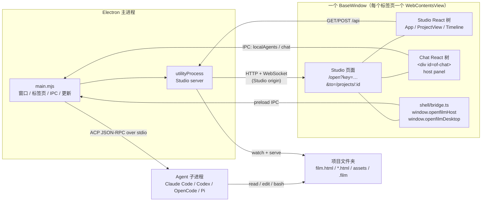
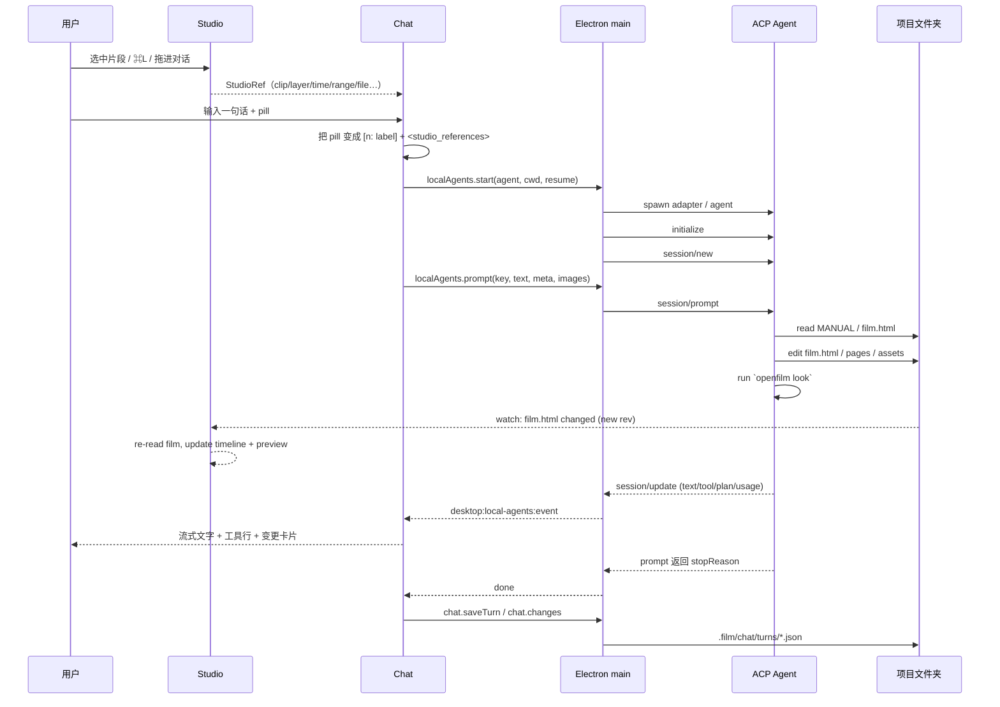

# OpenFilm 0.2.4 剪辑 Agent 设计拆解与复现手册

> 分析对象：`D:\OpenFilm`（已安装的 OpenFilm Desktop 0.2.4，Electron 应用）。
>
> 证据来源：
> - `D:\OpenFilm\resources\app.asar`（解包后的 `src/`、`shell/`、`node_modules/openfilm/`）。
> - 与安装包版本完全对应的源码标签：`openfilm/openfilm` 仓库 `v0.2.4`（commit `53156ac`）。
> - 本机浏览器实际加载 Studio 后的界面截图：`OpenFilm-Studio-实机截图.png`。
>
> 交付物（都在 `D:\Tools\openfilm\TEMP\OpenFilm-AI剪辑Agent`）：
> - 本文：`OpenFilm-AI剪辑Agent设计分析.md`
> - 可交互复现原型：`OpenFilm-AI对话剪辑界面.html`
> - 原型预览截图：`OpenFilm-AI对话剪辑界面-预览.png`
> - Studio 原始构建入口：`OpenFilm-Studio-原始index.html`
> - 桌面壳（Studio + 对话）原始构建入口：`OpenFilm-桌面壳-原始index.html`
> - 实机界面截图：`OpenFilm-Studio-实机截图.png`

---

## 一、一句话结论

OpenFilm 的“剪辑 Agent”不是一个内置的、会调用剪辑 API 的专用模型，而是：

> **一个 ACP 宿主 + 用户自己的 coding agent + 一个项目文件夹 + `openfilm` 命令行 + Studio 的实时文件监听。**

Agent 真正做的事情是：读 `film.html`、改页面/素材/时间线、运行 `openfilm look` 检查画面。Studio 只是“把磁盘上的项目实时画出来”的编辑器。对话列（chat）是同一个网页里、Studio 右侧的 host panel，不是另一个应用。

所以复现它的关键不是写一个“视频编辑 Agent 的提示词”，而是复现下面六个东西：

1. **ACP 会话宿主**：启动 Claude Code / Codex / OpenCode 等子进程，完成 `initialize → session/new → session/prompt`。
2. **工作目录与指令**：agent 的 `cwd` 是项目文件夹；第一条消息/系统提示告诉它“Studio 已经开着，改文件，不要开浏览器”。
3. **领域 CLI**：把 `openfilm` 放到 agent 的 `PATH` 第一位；它提供 `open`、`look`、`render`、`get`、`skills`。
4. **文件即真相**：`film.html` 是唯一的时间线；页面是 `*.html`；素材在 `assets/`。
5. **实时回写**：Studio 监听项目文件夹，`film.html` 变化就重读、重绘、刷新时间线。
6. **对话列**：会话、turn、事件流、权限/问题、引用 pill、模型菜单、日志、文件变更。

把这几层拆开，任何团队都可以在自己的编辑器里复现同样的体验。

---

## 二、总体架构

### 2.1 进程与页面



要点：

- **Studio server 是独立 utility process**（`studio-process.mjs`），不是 Electron 主进程里的 Express。
- 每个标签页是一个 `WebContentsView`，加载 Studio 自己的 origin。
- **Studio 与聊天在同一个页面、同一个 origin**：`shell/main.tsx` 同时渲染 `openfilm/studio-ui/App.tsx` 和 `mountChat(#of-chat)`。
- 聊天不是 iframe，也不是独立窗口。它是 Studio 页面里的一个 `position: fixed` 列，Studio 通过 `hostPanel` 把右侧宽度让出来。
- Agent 是第三个进程：Electron 主进程用 `child_process.spawn` 启动 ACP adapter 或 agent 本体，双方用 NDJSON/JSON-RPC over stdio 通信。

### 2.2 为什么是“一个页面”

`apps/desktop/shell/index.html` 的 body 只有：

```html
<div id="root"></div>
<div id="of-chat" class="of-chat" data-studio-host-panel tabindex="-1"></div>
<div id="of-chat-layer" class="of-chat" data-studio-host-panel tabindex="-1"></div>
```

`shell/main.tsx`：

```tsx
import './bridge';
import { App } from 'openfilm/studio-ui/App.tsx';
import { mountChat } from '../chat/src/mount';

applyStudioHost();
createRoot(document.getElementById('root')!).render(<App />);
void mountChat(document.getElementById('of-chat')!);
```

好处：

- 主题、语言、快捷键、弹层 z-index 天然一致；
- 聊天能直接读 Studio 的 `/api/projects/:id/files`，也能调用 Studio 的 host 命令；
- Studio 的 `hostPanel` 可以精确地把右侧宽度让出来，而不是两个窗口互相盖住；
- 聊天列和 Studio 的浮层共享 `#of-chat-layer`，菜单不会被 Studio 的画布裁掉。

### 2.3 关键尺寸

来自 `apps/desktop/src/window-state.mjs`：

```js
export const CHAT_MIN = 340;
export const CHAT_DEFAULT = 420;
export const STUDIO_MIN = 640;
export const WINDOW_MIN = { width: CHAT_MIN + STUDIO_MIN, height: 600 };
```

来自 `shell/bridge.ts`：

```ts
const TOP_BAR = 32;
const layout = { open: true, width: 420, min: 340, studioMin: 640 };
const shownWidth = () =>
  layout.open
    ? Math.max(Math.min(layout.width, innerWidth - layout.studioMin), Math.min(layout.min, innerWidth))
    : 0;
```

聊天列的 CSS（`shell/shell.css`）：

```css
#of-chat {
  position: fixed;
  right: 0;
  bottom: 0;
  z-index: 40;
  background: transparent;
}
#of-chat[hidden] { display: none; }
#of-chat[data-assets-open] { pointer-events: none; }
#of-chat[data-assets-open] aside { pointer-events: auto; }
#of-chat-layer { height: 0; background: transparent; }
```

Studio 让位：

```tsx
<section
  className="relative flex min-h-0 min-w-0 flex-col"
  style={{
    gridArea: 'main',
    ...(hostPanel?.open ? { marginRight: Math.max(0, hostPanel.width - DOCK_GAP) } : null)
  }}
>
```

---

## 三、一次“AI 剪辑”的完整链路

### 3.1 时序



### 3.2 分步说明

1. **用户在 Studio 里指东西**
   - 选中时间线片段、画面里的图层、画幅中的一个区域，或在标尺上标一个 range。
   - Studio 把它变成 `StudioRef`（见 `packages/openfilm/studio/ui/src/lib/host.ts`）。
   - `⌘L` / “Reference in chat” / 拖拽都会调用 `studioHost.refer(ref)`。

2. **引用变成消息里的编号**
   - 聊天把每个引用做成 pill。
   - 发送时，`resolvePromptReferences` 把 pill 变成 `[1: title]`、`[2: 0:02.1]`。
   - 消息末尾追加：

     ```text
     <studio_references film="film.html" stage="1920x1080">
     [1] clip `title` (title.html) · track 0 · 0.200–3.600 s of the film · film.html#0.0
     [2] moment 2.100 s
     </studio_references>
     ```

   - 引用如果带画面（viewer 截图、clip 首帧、region/layer 裁剪），会先由 Electron `desktop:capture` 截成 JPEG，存到 `.film/refs/<turn>-<n>.jpg`，并把路径写进引用行。支持图片的 agent 还会额外收到 ACP image block。

3. **聊天创建 turn**
   - 立刻在界面上显示用户消息和“正在处理”。
   - `app.chat.snapshot(project, turnId)` 记录项目当前文件快照，用于本轮结束时算 `fileChanges`。
   - turn 元数据（`LocalAgentTurnMeta`）包含：`turnId/projectId/sessionId/agent/prompt/turn/startedAt`，并写入 `.film/logs/<turn>.jsonl`。

4. **启动或复用 ACP 会话**
   - 页面对 `desktop:local-agents:start` 发 `{ agent, cwd, resume }`。
   - 主进程先看这个页面是否已经有一个同 agent、同 cwd、同 `sessionId` 的会话；有就复用，避免二次启动。
   - 否则 `new AgentSession(...)`，spawn adapter 或 agent 本体。

5. **ACP 握手**
   - `initialize`：告诉 agent 客户端能力（文件读写、终端、elicitation、terminal auth、notices）。
   - `session/new`：传 `cwd`，0.2.4 里 `mcpServers: []`。
   - Claude 的指令通过 `_meta.systemPrompt.append` 注入；Codex 通过 `CODEX_CONFIG.developer_instructions`；其余 agent 在第一条 prompt 前追加一段文本。
   - 如果 `resume` 存在且 agent 支持 `session/resume`，直接续；否则尝试 `session/load`（回放历史时 `replaying=true`，不回显）；都不行就新建。

6. **发送 prompt**
   - `session/prompt` 的参数是 `{ sessionId, prompt: [text, ...images] }`。
   - 对 byok（Pi）会带 `_meta.openfilm = { turnId, cwd }`，让它把每次模型请求写进本轮 `.model.jsonl`。
   - 超过 5 分钟没有任何 `session/update` 且 agent 处于 `model_requesting`，宿主会 `cancel`，避免聊天永远转圈。

7. **agent 真正剪辑**
   - 它用的是自己的工具：Claude Code 的 Read/Edit/Bash，Codex 的 shell/apply_patch，Pi 的 `read/bash/edit/write/ask`。
   - 项目里 `openfilm` 命令在 PATH 第一位（Electron 生成的 `.cmd` / shell 脚本，见 `openfilm-command.mjs`）。
   - 典型动作：
     ```bash
     openfilm                 # 读手册
     cat film.html            # 看时间线
     # 编辑 film.html / hero.html / feature.html / end.html
     openfilm look            # 生成 contact sheet，检查每一帧
     openfilm render          # 只有用户要 MP4 时
     ```
   - `openfilm look` 会把帧写到 `.film/cache/look/`，agent 通过读图片“看”自己的成片。

8. **Studio 自动刷新**
   - Studio 的 `watch.mjs` 用 `fs.watch(root, { recursive: true })` 监听项目。
   - `film.html` 变化 → 120ms 合并 → 重新计算 `rev = sha256(text).slice(0,16)` → 通过 WebSocket `/api/projects/:id/events` 发 `{ type: 'film', rev }`。
   - 前端收到后重新 `GET /api/projects/:id`（或 film 接口），更新 `film` 状态、时间线、预览 iframe。
   - 其他文件（页面、图片、声音）变化 → `{ type: 'files', paths }`，对应缩略图/页面重新加载。

9. **聊天收到 ACP 事件**
   - `session/update` 被投影成聊天认识的三种事件：
     - `agent_message_chunk` → 文字流
     - `agent_thought_chunk` → “Thought for …”
     - `tool_call` / `tool_call_update` → 工具行（读文件、编辑、命令、搜索）
     - `plan` → 计划行
     - `usage_update` → 上下文占用
     - `available_commands_update` → `/` 菜单
   - `session/request_permission` → `permission` 事件，聊天在 composer 上方显示允许/拒绝卡片。
   - `elicitation/create` → `question` 事件，支持 Claude 的 AskUserQuestion / Codex 的 request_user_input 表单。

10. **结束与持久化**
    - `prompt` 返回 `stopReason`（`end_turn` / `cancelled` / `refusal` …）。
    - 主进程写 `done`，并把本轮 agent 的模型请求从 agent 自己的记录（Claude/Codex 的 session 日志）读成 `.film/logs/<turn>.model.jsonl`。
    - 页面把 turn 和 transcript 存到 `.film/chat/turns/<turn>.json`。
    - `app.chat.changes` 对比 turn 开始时的快照，得到 `fileChanges`，显示在回复下方。
    - 会话的 `agentSessions[agent] = sessionId` 存进 `sessions.json`，下次继续。

---

## 四、Agent 运行时设计

### 4.1 支持的 Agent

`apps/desktop/src/agents.mjs` 的 `AGENTS`：

| id | 名称 | 启动方式 | 登录/状态 | 备注 |
| --- | --- | --- | --- | --- |
| `claude` | Claude Code | 官方 ACP adapter `@agentclientprotocol/claude-agent-acp`，用 `CLAUDE_CODE_EXECUTABLE` 指向用户自己的 `claude` | `claude auth status/login`；ACP terminal auth `claude-ai-login` | 只继承 shell 的 PATH/代理/配置目录/语言，避免 `ANTHROPIC_*` 覆盖订阅 |
| `codex` | Codex | 官方 ACP adapter `@agentclientprotocol/codex-acp` | `codex login status`；登录在 Codex 自己里 | Windows 下通过 UTF-8 `.cmd` 启动，避免中文控制台乱码 |
| `copilot` | GitHub Copilot | `copilot --acp --allow-all` | `copilot login` | `approve: true`，权限请求自动允许 |
| `cursor` | Cursor | `cursor --force acp` | `cursor status` / `cursor login`，ACP `authenticate: cursor_login` | `approve: true` |
| `opencode` | OpenCode | `opencode acp` | `opencode auth login` | `approve: true` |
| `codebuddy` | CodeBuddy | `codebuddy --acp --permission-mode bypassPermissions` | 程序自己登录 | 中国版默认 `CODEBUDDY_INTERNET_ENVIRONMENT=internal` |
| `qwen` | Qwen Code | `qwen --acp --approval-mode yolo` | 程序自己登录 | `approve: true` |
| `kimi` | Kimi | `kimi acp` | `kimi login` | `approve: true` |
| `minimax` | MiniMax Code | `minimax acp` | `minimax login` | `approve: true` |
| `byok` | Own key（Pi） | App 自带 `pi-agent.mjs`，通过 `@earendil-works/pi-coding-agent` SDK 运行 | `agent-roster` 里配置的 API key | 工具固定为 `read/bash/edit/write/ask` |

“用户的安装，而不是 App 内置”是刻意的：体积、订阅条款、登录凭据都留在用户自己的程序里。App 只运行 adapter 或 agent 本体，不接触 token。

### 4.2 ACP 生命周期

`AgentSession.start()` 的核心顺序：

```js
// 1. 找用户的 CLI
const shell = agentShell(agent, await loginShellVariables());
const cli = resolveAgentCli(agent, { pathDirs: shell.PATH.split(PATH_SEP) });

// 2. 组装环境：用户的 shell + App 的 binDir（openfilm） + ffmpeg fallback
const path = [opts.binDir, shell.PATH, opts.fallbackDir].filter(Boolean).join(PATH_SEP);
const env = childEnvironment({ shell: { ...shell, PATH: path }, extra });

// 3. spawn：原生 ACP agent 直接启动；adapter/Pi 用 Electron-as-Node 启动脚本
this.child = native
  ? spawn(native.cmd, native.args, { cwd, env, stdio: ['pipe','pipe','pipe'] })
  : spawn(node.command, [...nodeArgs, script], { cwd, env, stdio: ['pipe','pipe','pipe'] });

// 4. JSON-RPC over stdio
const stream = acp.ndJsonStream(Writable.toWeb(child.stdin), Readable.toWeb(child.stdout));
this.conn = acp.client({ name: 'openfilm-desktop' })
  .onRequest(acp.methods.client.session.requestPermission, handler)
  .onRequest(acp.methods.client.elicitation.create, handler)
  .onNotification(acp.methods.client.session.update, handler)
  .connect(stream);

// 5. 握手
const init = await conn.agent.request(acp.methods.agent.initialize, {
  protocolVersion: acp.PROTOCOL_VERSION,
  clientCapabilities: CLIENT_CAPABILITIES,
  clientInfo: CLIENT_INFO,
});

// 6. 新建 / 恢复
const params = {
  cwd,
  mcpServers: [],
  ...(skills?.additionalDirectories ? { additionalDirectories: skills.additionalDirectories } : {}),
  ...(claude ? { _meta: { systemPrompt: { append: instructions } } } : {}),
};
let session = null;
if (resume && caps.sessionCapabilities?.resume) {
  session = await conn.agent.request(acp.methods.agent.session.resume, { ...params, sessionId: resume });
} else if (resume && caps.loadSession) {
  replaying = true;
  session = await conn.agent.request(acp.methods.agent.session.load, { ...params, sessionId: resume });
  replaying = false;
}
session ??= await conn.agent.request(acp.methods.agent.session.new, params);
```

### 4.3 客户端能力

```js
export const CLIENT_CAPABILITIES = {
  fs: { readTextFile: false, writeTextFile: false },
  terminal: false,
  elicitation: { form: {} },
  auth: { terminal: true },
  session: { notices: {} },
  _meta: { jetbrains: { air: { version: 1, capabilities: ['recommendedValue'] } } },
};
```

含义：

- 文件读写和终端不由 ACP 客户端代理，agent 用自己的工具直接操作 `cwd`。
- 支持 ACP 的 form elicitation，用于“问用户问题”。
- 登录在 Terminal 里进行，App 不接管密码。
- 支持 agent 的 notices（Codex 的断线重连、上下文压缩警告等）。

### 4.4 会话、续接、空闲与恢复

- 一个 `(projectId, conversationId, agent)` 对应一个 `LiveSession`（聊天侧 `local-agent-run.ts` 的 `sessions` Map）。
- 会话 key 是随机 UUID；`info.sessionId` 是 agent 自己的会话 id，存进 `sessions.json` 的 `agentSessions[agent]`。
- 页面刷新：
  - `desktop:local-agents:running` 返回仍在运行的 turn（含 `meta` 和所有事件）。
  - 页面重放事件到新的 `LocalAgentTurn`，继续监听同一个 key。
  - 完成后 `ack`，主进程忘掉这个 turn。
- 空闲 20 分钟自动关闭进程（`IDLE_MS`），下次发言用 agent 自己的 `resume` 续上。
- 技能/MCP 变更：`refreshSkills` 会关闭空闲会话；正在跑的在 turn 结束后 3 秒关闭，让下一条消息带上新配置。

### 4.5 权限与提问

**权限请求**：

```js
.onRequest(acp.methods.client.session.requestPermission, async (ctx) => {
  const optionId =
    (this.spec.approve ? allowOption(ctx.params) : null)
    ?? (this.opts.onPermission ? await this.opts.onPermission(ctx.params) : null);
  return optionId
    ? { outcome: { outcome: 'selected', optionId } }
    : { outcome: { outcome: 'cancelled' } };
});
```

- `approve: true` 的 agent（Copilot、Cursor、OpenCode、CodeBuddy、Qwen、Kimi、MiniMax）直接选 `allow_always` 或 `allow_once`。
- Claude Code / Codex 默认把请求交给聊天，由用户点“允许一次 / 总是允许 / 拒绝”。
- 权限卡片显示在 composer 上方，agent 的 `session/prompt` 会一直等待答复。

**问题**：

- Claude 的 `AskUserQuestion`、Codex 的 `request_user_input` 都会以 ACP form 到达。
- `formQuestions(params)` 把表单读成 `{ id, question, header, options, customId, multi }`。
- 聊天的 `TurnQuestionCard` 显示选项；`formContent(questions, answers)` 把答案写回表单字段。
- 用户跳过（`null`）时返回 `{ action: 'decline' }`，agent 按自己的判断继续。

### 4.6 错误与诊断

`agents.mjs` 对失败做了很细的分类：

- `not-installed`：找不到 CLI；
- `not-ready`：byok 还没配置 key；
- `sign-in`：ACP `auth_required`；
- `agent-error`：agent 自己的错误（如订阅不支持）；
- `outdated`：Codex 太旧；
- `agent-stalled`：模型 5 分钟无响应；
- `empty-turn`：agent 结束但一个字没说；
- `Internal error` 里带 `data.message/details` 的，会被还原成真正原因；
- stderr 只取最后 3 条“像错误”的行，避免堆栈刷屏。

这些信息会进入：
- 聊天气泡上方的错误行；
- `.film/logs/<turn>.jsonl` 的 `done` 事件；
- Studio 的 `problems.json`（`openfilm/problems`），用于“复制诊断报告”。

---

## 五、上下文设计

### 5.1 普通 agent 的 `INSTRUCTIONS`

对于 Claude Code、Codex、Copilot 等，App 会加一段（不是完整系统提示，而是追加/首条消息）：

```text
You are working inside OpenFilm, a desktop app for making videos. Beside this chat the person sees OpenFilm Studio,
the video editor, showing the project in your working directory; it updates live as you save files.

The project is an OpenFilm film: pages with window.film, cut together by film.html. Before you change anything, run
`openfilm` with no arguments and read the manual it prints; follow it. Use the `openfilm` command on your PATH (this
app's own, on the Studio beside you), not `npx openfilm`, whatever a skill says. Studio is already open on this
project: you never need `openfilm open` and never open Studio in a browser. Run `openfilm look` after each change
to see what you made. Render the MP4 only when the person asks for it; they can also export from Studio. Reply in the
language the person writes in.

When the person mentions something in Studio, they may name a clip, a page or a moment (as seconds); find it in
film.html and the project's files.

In your replies you can point at things in Studio for the person: [[clip:ID]] (a clip, by its id in film.html),
[[t:SECONDS]] (a moment), [[range:START-END]] (a stretch, in seconds), [[track:N]] (a track, 0 is the first) and
[[file:PATH]] (a file of the project). They show as links that open it in Studio.
```

这段的重点：

- **Studio 已经开着**，不要 `openfilm open`，不要开浏览器；
- **只改项目文件夹**；
- **先读 `openfilm` 手册**；
- **每次改完 `openfilm look`**；
- **不要主动 render**，除非用户要；
- **用用户的语言回复**；
- **回复里可以用 `[[clip:…]]` 指回 Studio**。

### 5.2 byok（Pi）的完整系统提示

`ownAgentPrompt()` 把三样东西拼起来：

1. `agent-prompt.md`（45 行，定义“你是谁、怎么工作、怎么说话”）；
2. `STUDIO_REFERENCES`（怎么指回 Studio）；
3. `MANUAL.md` 全文（`openfilm` 打印给 agent 的手册）。

`agent-prompt.md` 的要点：

- “You are the agent inside the OpenFilm desktop app. You make films with the person…”
- 先理解需求 → 按镜头规划 → 分步制作 → `openfilm look` 检查 → 告诉用户；
- 不要中途停下来问“要不要继续”；
- 只在“猜错会浪费用户时间/钱”时用 `ask`；
- 不要问能自己查到的东西，不要请求做已经被要求做的事；
- 多数用户不写代码，谈画面、台词、节奏、音乐，不谈代码/命令/路径；
- 没看过之前，绝不说“可以了”。

### 5.3 Skills 的注入

`agent-skills.mjs` 把“OpenFilm 的 skills + 用户自己的 skills + MCP servers”按每个 agent 的机制注入：

| Agent | OpenFilm skills | 用户自己的 skills | 用户自己的 MCP |
| --- | --- | --- | --- |
| Claude Code | 本地 plugin（`plugins: [{ type:'local', path }]`） | 默认关闭（`skillOverrides`），放行的才开 | 默认 deny（`deniedMcpServers`），放行的才开 |
| Codex | ACP `additionalDirectories`（它读 `<dir>/.agents/skills`） | `CODEX_CONFIG.skills.config[].enabled=false` | `mcp_servers.<name>.enabled=false` |
| OpenCode | `OPENCODE_CONFIG_CONTENT.skills.paths` | `permission.skill` 逐项 allow/deny | `mcp.<name>.enabled=false` |
| Qwen Code | 系统默认文件 `skills.directories` | `skills.disabled` | `mcp.excluded` |
| Copilot | `COPILOT_SKILLS_DIRS` | 无法隐藏，保留用户的全部 | `--disable-mcp-server` |
| Pi（byok） | 只加载 OpenFilm 的 skills | 无 | 无 |
| CodeBuddy / Cursor / Kimi / MiniMax | 不额外注入；消息里点名时由聊天附上 SKILL.md | 用户终端里本来有什么就有什么 | 同左 |

注意：0.2.4 的 `session/new` 里 `mcpServers: []`。这里的 MCP 是 agent 自己配置里的 MCP，不是 App 临时注入的。

### 5.4 引用的文本格式

`studio-refs.ts` 的 `studioReferencesText` 会把引用写成 agent 能读的块。每种引用一行，包含：

- clip：`clip \`id\` (src) · track N · start–end s of the film · in X s · speed S · film.html#track.clip`
- layer：`layer <tag> "text" in clip \`id\` at X s · x= y= w= h= · source file:line`
- region：`region of the picture at X s · x= y= w= h= · clips … · words: "…"`
- time：`moment X s`
- range：`range start–end s · clips …`
- track：`track N "name" · clips …`
- file：`file path (kind, w×h, duration)`
- subtitle：`subtitle start–end s "text" (lang) · line N`
- example：`example film "title" (another OpenFilm film…) · folder … · source …`

如果引用有图片，行末加 `· picture: .film/refs/<turn>-<n>.jpg`。

### 5.5 附件与图片

- 拖入/粘贴的文件：磁盘上的文件只记路径；没有路径的（截图、剪贴板图片）存到 `.film/attachments/<name>`。
- 引用的画面：`desktop:capture` 截取 viewer（隐藏选择框/手柄，保留字幕），存 `.film/refs/<turn>-<n>.jpg`。
- 支持图片的 agent：额外发送 ACP image block（base64，最多 20 张，每张 ≤ 8MB base64，JPEG/PNG/WebP）。
- 不支持图片的 agent：文本里仍然有图片路径，它可以自己打开。

### 5.6 上下文预算

- 上下文由 agent 自己管理（Claude/Codex 自己的压缩；Pi 的 compaction）。
- App 通过 `usage_update` 读 `used/size`，在 85% 时提示“新开一个对话”。
- 聊天不会把整份 `film.html` 塞进 prompt；它只给引用块、附件、skill 文本。agent 需要时自己读文件。
- 这是 OpenFilm 比“把分镜 JSON 全塞进 prompt”更稳的地方：**文件是外部记忆，上下文只放指针**。

---

## 六、工具与编辑边界

### 6.1 Agent 到底能做什么

| 能力 | 实现 |
| --- | --- |
| 读项目文件 | agent 自己的 Read / shell |
| 改 `film.html` | agent 自己的 Edit / apply_patch / shell |
| 改页面 | 直接写 `*.html` |
| 生成素材 | `openfilm get`（需要用户在 Studio 连接 provider） |
| 检查成片 | `openfilm look`（contact sheet + 确定性检查） |
| 导出 | `openfilm render`，或用户在 Studio 导出 |
| 使用技能 | `openfilm skills` / `openfilm skill <name>`，或聊天里的 Skills |
| 问用户 | agent 自己的 AskUserQuestion / request_user_input，或 Pi 的 `ask` |

**没有**：`add_clip`、`set_duration`、`move_clip` 这类“剪辑工具”。Agent 是直接改 HTML 的。

### 6.2 为什么这样设计

- 视频的“编辑”最终是网页：页面、CSS、`frame(t)`、媒体片段。让 agent 直接写网页，表达力最大。
- 不需要为每个剪辑动作设计 JSON schema；agent 已经会 HTML/CSS/JS。
- Studio 是确定性的：它只读 `film.html`，按协议渲染；agent 写坏了，画面会报错，`openfilm look` 也会报错。
- 代价：agent 可能写出 Studio 不认识的结构；所以 `openfilm look` 和严格解析是质量闸门。

### 6.3 Studio 自己的编辑操作

Studio GUI 的编辑不走 agent，而是 `POST /api/projects/:id/edit`，带 `{ base, ops }`。`ops` 是受控操作，按 **clip id** 而不是位置：

| op | 作用 |
| --- | --- |
| `set` | 设置 clip 的 `at/time/box/size/volume/speed/overrides/src` |
| `move` | 移动到某个时间/轨道 |
| `insert` | 插入新 clip（或复制 `from`） |
| `remove` | 删除 clip |
| `split` | 拆分（可给左右半段的字段） |
| `props` | 批量属性（字段、轨道、轨道顺序） |
| `stage` | 修改画布尺寸 |
| `fields` | 原样写回 clip 字段（undo 用） |
| `track` | 锁定/隐藏/静音轨道 |
| `reorder` | 重排轨道 |

写入流程：

```js
const current = await readProjectFilm(root);
const value = applyOps(structuredClone(current.value ?? EMPTY_FILM), ops);
const { doc, problems } = readFilm(value);
if (!doc) throw new EditError(problems.join('\n'), 'invalid');
const written = await writeProjectFilm(root, value, current.text);
return { ...written, value, doc, rebased: base != null && base !== current.rev };
```

- `base` 是编辑开始时的 `rev`。
- 文件被 agent 改过（`base !== current.rev`）时，操作会在最新文件上重放；如果某个 clip id 已经不在了，整个编辑失败（409），而不是落到另一个 clip 上。
- 这保证了“人”和“agent”同时改同一个 `film.html` 时不会静默错位。

### 6.4 锁定轨道的真实边界

`MANUAL.md` 对 agent 说：

> A track the person `locked` is theirs: change nothing on it.

Studio 的 GUI 也会阻止对锁定轨道的编辑。但 **agent 是直接写 `film.html` 的**，0.2.4 没有在文件写入层强制拦截“锁定轨道”。因此：

- 锁定是**协议约定 + 提示词约束 + Studio GUI 约束**；
- 不是内核级强制；
- 如果要复现得更硬，应该在 agent 写入后做一次结构校验，发现锁定轨道被改就拒绝/回滚。

这是 OpenFilm 设计里一个值得注意的取舍：它把“agent 当协作者”而不是“不可信进程”。

---

## 七、数据模型

### 7.1 `film.html`

一个 film 是一个网页：

```html
<!doctype html>
<html>
<head>
<meta charset="utf-8">
<meta name="viewport" content="width=1920, height=1080">
<style>
  .card { object-fit: cover; border-radius: 24px; }
</style>
</head>
<body>
<section>
  <iframe id="title" src="title.html#t=0,4" at="0"></iframe>
</section>
<section>
  <video id="hero" src="assets/a.mp4#t=2,8" at="2" speed="0.5" volume="0.8" class="card"
         style="left:160px;top:90px;width:1600px;height:700px"></video>
</section>
<section>
  <audio id="bed" src="assets/bed.mp3" volume="0.6"></audio>
</section>
</body>
</html>
```

- 每个 `<section>` 是一条轨道；第一个在最上层。
- clip 是 `<iframe>` / `<video>` / `` / `<audio>`。
- `src` 用 media fragment `#t=in,out` 表示素材入出点。
- `at` 是片子上的开始秒数。
- `left/top/width/height/rotate` 在 `style` 里，单位是舞台像素。
- `speed` 0.25–4；`volume` 线性增益；`muted`。
- `overrides` 是人在 Studio 里对页面元素的修改（JSON）：`at` 选择器、`text`、`style`、`t/s/r`、`fade`、`lock`。
- `id` 在片内唯一；没有就用文件名。
- `size` 是页面在没有自身宽高时的布局尺寸。

页面协议：

```js
window.film = {
  frame(t) { /* 画出 t 秒的完整画面 */ }, // 可以返回 Promise
  duration: 6,                 // 可选：页面自己的长度
  ready: loadEverything(),     // 可选：Promise
  width: 480, height: 320,     // 可选：页面只占画面的一部分
};
```

**唯一规则**：同一个 `t` 必须画出同一张图，不管之前画过什么、按什么顺序画。Studio 依赖这一点做 scrub、并行渲染、运动模糊、单镜头重渲。

### 7.2 Revision

`film.mjs`：

```js
export const revOf = (text) =>
  createHash('sha256').update(text).digest('hex').slice(0, 16);
```

- 每次读 `film.html` 都算 `rev`。
- 前端编辑带 `base: rev`。
- 文件被 agent 改过时，`rebased: true`，操作重放；找不到 clip 就 409。
- watcher 只在 `rev` 变化时发事件，避免同文本保存造成无意义刷新。

### 7.3 `.film/` 目录

```
<project>/
  film.html
  *.html
  assets/
  .film/
    chat/
      sessions.json                 # 对话列表 + last
      turns/<turn>.json             # 完成的 turn：turn + items（聊天显示用）
      agent/                        # byok（Pi）自己的会话记录
    logs/
      <turn>.jsonl                  # 本轮所有事件（prompt/update/permission/done…）
      <turn>.model.jsonl            # 本轮每次模型请求 + 回答（只存增量）
    refs/
      <turn>-<n>.jpg                # 引用 [n] 的画面
    attachments/
      <name>                        # 粘贴进来的文件
    cache/
      look/                         # openfilm look 生成的帧
      render/                       # 局部导出
```

`chat-store.mjs` 的关键约定：

- `turn.id` 允许 `local:...`；文件名把 `:` 换成 `-`。
- `sessions.json` 原子写。
- turn 的 transcript 只保存“已经结束”的；运行中的每 1.5 秒落一次“resting”副本，应用崩溃后能恢复。
- 模型日志只存增量：`prefix` 表示前一次请求的前多少条消息相同，只写新增的 `messages`；`systemPrompt` / `tools` 只在变化时写。

### 7.4 Turn / Transcript

聊天的 turn 形状（简化）：

```ts
interface Turn {
  id: string;                 // local:xxxx
  status: 'generating' | 'ready' | 'error' | 'canceling' | 'cancelled';
  createdAt: string;
  settledAt?: string;
  prompt: string;             // 用户原文（pill 已展开成 [n: label]）
  promptDisplay?: unknown;    // 发送时的 pill 布局
  attachments: TurnAttachment[];
  localAgent?: { id: LocalAgentId; model: string | null };
  origin?: 'background';
  fileChanges?: FileChange[];
}
```

Transcript item（聊天一行）：

```ts
type TranscriptItem =
  | { kind:'text'; text:string; id:string; pending?:boolean }
  | { kind:'thought'; text:string; ... }
  | { kind:'plan'; plan:Array<{content:string;status:'pending'|'in_progress'|'completed'}> }
  | { kind:'act'; act:AgentAct; detail?:string; ask?:...; ... }
  | { kind:'notice'; text:string; ... };
```

ACP 事件到 Transcript 的投影在 `local-agent-run.ts`：

- `agent_message_chunk` → `agent-text`；
- `agent_thought_chunk` → `agent-thinking`；
- `tool_call` → `agent-act`（根据 `kind` 映射到 `files.read` / `files.edit` / `command.run` / `research.search` …）；
- `tool_call_update` → `agent-act-done`；
- `usage_update` → 上下文占用；
- `available_commands_update` → `/` 菜单；
- `plan` → 计划行。

---

## 八、剪辑界面设计

### 8.1 桌面布局

```
┌──────────────────────────────────────────────────────────────────────────┐
│ 32px 顶栏：Logo / 更新 / 项目名（居中） / 主题 / 对话开关 / 布局 / 导出    │
├───────────────────────────────────────────────┬──────────────────────────┤
│                                               │                          │
│   Viewer（监视器）                            │   Chat（host panel）      │
│   ┌───────────────────────────────────────┐   │   ┌──────────────────┐   │
│   │ 16:9 stage                            │   │   │ 会话标题  + 历史 │   │
│   │                                       │   │   ├──────────────────┤   │
│   └───────────────────────────────────────┘   │   │ 用户气泡          │   │
│   ▶ 00:00:00 / 00:14:18   循环 统计 全屏     │   │ 工作摘要           │   │
│                                               │   │ 工具行             │   │
│   Inspector（检查器，286px）                  │   │ 回复               │   │
│   画布 / 帧率 / 内容 / 片段属性               │   │ 文件变更           │   │
│                                               │   │ ─────────────────  │   │
│                                               │   │ 权限 / 问题卡片    │   │
│                                               │   │ Composer           │   │
│                                               │   │ 模型 / 附件 / 素材 │   │
├───────────────────────────────────────────────┴──────────────────────────┤
│ Timeline（≈238px）：工具条 + 轨道头 + 标尺 + 轨道 + 片段 + 播放头         │
└──────────────────────────────────────────────────────────────────────────┘
```

桌面版有一个重要细节：**聊天列存在时，Studio 的素材面板默认不在左侧**，而是由聊天列的“素材”按钮打开，盖在聊天列上方，Studio 只保留 composer 的高度。源码里：

```tsx
const hostAssets = hostPanel?.assets ?? null;
...
{!hostAssets && assetsPaneOpen && assetsFit ? (
  <div className={PANE}>… Studio 自己的素材面板 …</div>
) : null}
...
{hostAssets?.open && hostPanel ? (
  <div className="fixed z-30 ..." style={{ top: HOST_PANEL_TOP, right: DOCK_GAP, bottom: hostAssets.bottom, width: hostPanel.width - 2*DOCK_GAP }}>
    {mediaPool()}
  </div>
) : null}
```

这就是为什么桌面版在 1440 宽时仍然是“监视器 + 检查器 + 聊天”，而不是“素材 + 监视器 + 检查器 + 聊天”四列。

### 8.2 视觉 token

深色（默认）：

```css
--dock-shell:#111111;
--dock-pane:#181818;
--surface:#202020;
--surface-2:#2a2a2a;
--border:rgba(255,255,255,.06);
--text:#dadada;
--text-dim:#f0f0f0;
--text-muted:#7f7f7f;
--text-faint:#646464;
--accent:#1a93fe;
--composer-bg:#202020;
--tl-lane:#1e1e1e;
--tl-lane-on:#272727;
--tl-playhead:#ffffff;
--tl-accent:#45c2b4;
--tl-scene:#1d5c60;
--tl-video:#2d4f7c;
--tl-voice:#003a4c;
--tl-music:#00323f;
```

时间线的颜色不是按“轨道”固定，而是按 clip 类型：

- 页面 / MG：深青
- 视频：深蓝
- 旁白：深紫蓝
- 音效：蓝绿
- 音乐：深青绿
- 字幕：灰蓝

选中是白色 2px 内描边；播放头是白色 1px + 顶部小三角。

### 8.3 聊天列的结构

```
chat
├─ chat-head          会话标题、+、历史
├─ chat-scroll        对话滚动区
│  └─ turns
│     ├─ ask          用户气泡 + 时间/复制
│     └─ reply
│        ├─ work      折叠的“Worked 8s · 4 steps”
│        ├─ answer    流式回复
│        ├─ changes   本轮改了什么文件
│        └─ footer    复制 / Log / agent 图标 / 模型 / 时间 / 停止原因
├─ cards              权限、问题、spend 确认
├─ composer
│  ├─ pills           引用 pill
│  ├─ textarea
│  └─ bottom          附件 / 示例 / 素材 / 发送
└─ model row          模型 + 思考强度
```

### 8.4 引用 pill 与双向高亮

- Studio 的 `StudioRef` 种类：`clip`、`layer`、`region`、`time`、`range`、`track`、`file`、`subtitle`、`example`。
- 聊天把每种 ref 映射成 pill 的 `kind` 与 label。
- 鼠标悬停 pill：
  - 聊天调用 `app.highlightInStudio(ref)`；
  - Studio 在画布/时间线上加高亮，不移动播放头。
- 鼠标悬停 Studio 里的 clip/layer：
  - Studio 调 `onHover(ref)`；
  - 聊天把指向同一对象的 pill 点亮。
- 点击已发送消息里的 pill：
  - `app.showInStudio(ref)`；
  - Studio 执行 `select-clip` / `seek` / `show-range` / `show-box` / `show-track` / `show-file` / `show-subtitle`。
- 消息正在写时，`draftRefsInStudio` 会在 Studio 里给引用标上相同的编号。

### 8.5 权限 / 问题卡片

权限卡片（`ComposerCard`）：

- 标题：`{agent} 想要 …`
- 正文：工具名/命令
- 按钮：拒绝 / 允许一次 / 总是允许
- 数字键 1–9 可以选；Esc 取消。

问题卡片（`LocalAgentQuestionCard`）：

- 每个问题一个字段；
- 选项一行一个，带序号和描述；
- 支持“用自己的话回答”；
- 提交后 `formContent` 写回 ACP form。

### 8.6 模型菜单

`ModelPopover` 的结构：

1. 标题 + Settings → Agents；
2. 已启用的 agent 列表（状态：ready / sign-in / missing / key / checking）；
3. 当前 agent 的 `configOptions`：模型、思考强度、速度；
4. 每一项右侧显示当前值，点击打开侧菜单。

模型切换走 ACP：

- `session/set_config_option`（新协议）；
- 旧协议回退到 `session/set_model` / `session/set_mode`。

### 8.7 会话栏

- 标题来自第一条消息（去掉 `[n: label]` 的编号）。
- 点击标题就地重命名。
- `+` 新对话：只有当前没有 turn 在跑时可用（一个项目同一时间只允许一个 agent 在写）。
- 历史：今天/昨天/过去 7 天/更早，带搜索。
- 会话切换会切换 `agentSessions`，每个对话有自己独立的 agent 会话。

### 8.8 Developer 模式

`Settings → Developer` 两个开关：

- `logs`：每个 turn 的 footer 出现 `Log` 按钮，打开 `.film/logs/<turn>.jsonl`，可以看到：
  - `prompt`：发给 agent 的完整文本、引用块、图片数量；
  - `start` / `update` / `permission` / `question` / `answer` / `done`；
  - 每个 `tool_call` 的 `rawInput` 和结果；
  - 模型请求（另一个 tab）。
- `changes`：回复下方显示 `FileChangesList`，即本轮改了哪些文件、增删行数。

### 8.9 实际 HTML 文件

- `OpenFilm-Studio-原始index.html`：安装包里 Studio 的构建入口，引用 `/assets/index-OHfhKWvX.js` 和 `/assets/index-4w_4bVMU.css`。它不是独立可打开的文件；要配合 Studio server 和 assets。
- `OpenFilm-桌面壳-原始index.html`：桌面壳的构建入口，包含 `#of-chat` / `#of-chat-layer`，引用 `/assets/index-C6fZf4N7.js` / `index-D5M50RRH.css`。
- `OpenFilm-AI对话剪辑界面.html`：**自包含、可双击打开**的复现原型。它把 Studio 的视觉、时间线、检查器和聊天列都做进一个文件，并用一个 mock ACP agent 演示真实的交互链路。

---

## 九、复现蓝图

### 9.1 最小可行版本（MVP）

目标：让用户能在编辑器里说一句话，agent 改 `film.html`，画面和时间线自动刷新。

技术栈建议：

- Electron + React + TypeScript；
- Node 22+；
- `@agentclientprotocol/sdk`；
- 一个本地 HTTP server（Express/Hono 均可）托管编辑器与项目文件；
- `chokidar` 或 `fs.watch` 监听项目；
- 一个 `film.html` 解析器（可直接用 `openfilm` 的 `readFilm` / `filmHtml`，MIT）。

目录：

```
app/
  electron/
    main.ts                 # 窗口、IPC、agent 进程
    preload.ts              # contextBridge
    agents/
      acp-session.ts        # 启动/握手/prompt/cancel
      roster.ts             # 发现 CLI、状态、模型
      skills.ts             # skills/MCP 注入
    chat/
      store.ts              # .film/chat、logs、refs
      file-changes.ts       # 快照/差异
  renderer/
    studio/                 # 编辑器（或复用 openfilm/studio-ui）
    chat/                   # 对话列
    bridge.ts               # hostPanel / StudioRef
  project/
    film.html
    *.html
    assets/
    .film/
```

### 9.2 ACP 会话骨架

```ts
import * as acp from '@agentclientprotocol/sdk';
import { spawn } from 'node:child_process';
import { acpNdJsonStream } from './ndjson'; // 或 acp.ndJsonStream

export class AgentSession {
  private conn: any;
  private child: any;
  sessionId: string | null = null;
  info: any = null;

  async start({ agent, cwd, resume, env, onUpdate, onPermission, onQuestion }: any) {
    const spec = AGENTS[agent];

    this.child = spawn(spec.command, spec.args, {
      cwd,
      env,
      stdio: ['pipe', 'pipe', 'pipe'],
      windowsHide: true,
    });

    const stream = acp.ndJsonStream(
      Writable.toWeb(this.child.stdin),
      Readable.toWeb(this.child.stdout),
    );

    this.conn = acp.client({ name: 'my-editor' })
      .onRequest(acp.methods.client.session.requestPermission, async (ctx) => {
        const optionId = await onPermission(ctx.params);
        return optionId
          ? { outcome: { outcome: 'selected', optionId } }
          : { outcome: { outcome: 'cancelled' } };
      })
      .onRequest(acp.methods.client.elicitation.create, async (ctx) => {
        const answers = await onQuestion(ctx.params);
        return answers
          ? { action: 'accept', content: answers }
          : { action: 'decline' };
      })
      .onNotification(acp.methods.client.session.update, (ctx) => {
        onUpdate(ctx.params.update);
      })
      .connect(stream);

    const init = await this.conn.agent.request(acp.methods.agent.initialize, {
      protocolVersion: acp.PROTOCOL_VERSION,
      clientCapabilities: {
        fs: { readTextFile: false, writeTextFile: false },
        terminal: false,
        elicitation: { form: {} },
        auth: { terminal: true },
        session: { notices: {} },
      },
      clientInfo: { name: 'my-editor', title: 'My Editor', version: '0.1.0' },
    });

    const params = {
      cwd,
      mcpServers: [],
      _meta: { systemPrompt: { append: INSTRUCTIONS } }, // Claude 的放法
    };

    let session = null;
    if (resume && init.agentCapabilities?.sessionCapabilities?.resume) {
      session = await this.conn.agent.request(
        acp.methods.agent.session.resume,
        { ...params, sessionId: resume },
      ).catch(() => null);
    }
    session ??= await this.conn.agent.request(acp.methods.agent.session.new, params);
    this.sessionId = session.sessionId;
    this.info = {
      sessionId: session.sessionId,
      configOptions: session.configOptions ?? null,
      promptCapabilities: init.agentCapabilities?.promptCapabilities ?? null,
      steering: init._meta?.steering?.supported === true,
    };
    return this.info;
  }

  async prompt(text: string, images: any[] = []) {
    return this.conn.agent.request(acp.methods.agent.session.prompt, {
      sessionId: this.sessionId,
      prompt: [{ type: 'text', text }, ...images.map((i) => ({
        type: 'image', data: i.data, mimeType: i.mimeType,
      }))],
    });
  }

  cancel() {
    return this.conn.agent.notify(acp.methods.agent.session.cancel, {
      sessionId: this.sessionId,
    });
  }
}
```

### 9.3 指令模板

```ts
export const INSTRUCTIONS = `You are working inside My Editor, a desktop app for making videos.
Beside this chat the person sees the editor, showing the project in your working directory; it updates live as you save files.

The project is a film: pages with window.film, cut together by film.html. Before you change anything, run
\`film\` with no arguments and read the manual it prints; follow it. Use the \`film\` command on your PATH, not
\`npx film\`. The editor is already open: never run \`film open\` and never open it in a browser. Run \`film look\`
after each change to see what you made. Render the MP4 only when the person asks for it.

When the person mentions something in the editor, they may name a clip, a page or a moment (as seconds); find it
in film.html and the project's files.

In your replies you can point at things for the person: [[clip:ID]] (a clip), [[t:SECONDS]] (a moment),
[[range:START-END]] (a stretch), [[track:N]] (a track, 0 is the first), [[file:PATH]] (a project file).
They show as links that open it in the editor.`;
```

### 9.4 文件监听 + revision

```ts
import { watch } from 'node:fs';
import { createHash } from 'node:crypto';

let lastRev = '';
let timer: NodeJS.Timeout | null = null;
let pending = new Set<'film' | 'files'>();

const flush = async () => {
  timer = null;
  if (pending.has('film')) {
    const text = await readFile(join(root, 'film.html'), 'utf8');
    const rev = createHash('sha256').update(text).digest('hex').slice(0, 16);
    if (rev !== lastRev) {
      lastRev = rev;
      broadcast({ type: 'film', rev });
    }
  }
  if (pending.has('files')) broadcast({ type: 'files' });
  pending.clear();
};

watch(root, { recursive: true }, (_event, name) => {
  if (!name) return;
  if (name === 'film.html') pending.add('film');
  else pending.add('files');
  if (!timer) timer = setTimeout(flush, 120);
});
```

前端收到 `film` 事件后，重新拉取 film 文档，更新状态和时间线。注意：

- 读 `film.html` 一定要在 120ms 合并之后；
- Studio 自己的临时文件（`.tmp`、`.importing`）要忽略；
- 用 `rev` 去重，不要只看 mtime。

### 9.5 引用协议

```ts
type StudioRef =
  | { kind:'clip'; id:string; src:string; start:number; end:number; track?:number; in?:number; speed?:number }
  | { kind:'layer'; label:string; clipId:string; text:string; time?:number; box?:Box }
  | { kind:'region'; time:number; box:Box; clipIds:string[]; texts:string[] }
  | { kind:'time'; time:number }
  | { kind:'range'; start:number; end:number; clipIds:string[] }
  | { kind:'track'; track:number; label:string; clipIds:string[] }
  | { kind:'file'; path:string; fileKind:string; duration?:number; w?:number; h?:number }
  | { kind:'subtitle'; start:number; end:number; text:string; lang?:string };

function referencesText(refs: StudioRef[], stage: {w:number;h:number}) {
  if (!refs.length) return '';
  const lines = refs.map((r, i) => {
    switch (r.kind) {
      case 'clip':
        return `[${i+1}] clip \`${r.id}\` (${r.src}) · track ${r.track ?? 0} · ${r.start.toFixed(3)}–${r.end.toFixed(3)} s of the film · in ${(r.in ?? 0).toFixed(3)} s`;
      case 'time':
        return `[${i+1}] moment ${r.time.toFixed(3)} s`;
      case 'file':
        return `[${i+1}] file ${r.path}`;
      default:
        return `[${i+1}] ${JSON.stringify(r)}`;
    }
  });
  return `\n\n<studio_references film="film.html" stage="${stage.w}x${stage.h}">\n${lines.join('\n')}\n</studio_references>`;
}
```

### 9.6 一个最小的 mock agent（用于前端联调）

```ts
async function runMockTurn(turn, text, { onUpdate, cwd }) {
  onUpdate({ sessionUpdate: 'tool_call', toolCallId: 'c1', title: 'Read film.html', kind: 'read' });
  await sleep(300);
  onUpdate({ sessionUpdate: 'tool_call_update', toolCallId: 'c1', status: 'completed' });

  // 改 film.html（真实实现里由 coding agent 完成）
  const doc = await readFilm(cwd);
  applyEdit(doc, text);
  await writeFilm(cwd, doc);

  onUpdate({ sessionUpdate: 'tool_call', toolCallId: 'c2', title: 'Run openfilm look', kind: 'execute' });
  await sleep(500);
  onUpdate({ sessionUpdate: 'tool_call_update', toolCallId: 'c2', status: 'completed' });

  for (const ch of '已经改好了。') {
    onUpdate({ sessionUpdate: 'agent_message_chunk', content: { type: 'text', text: ch } });
    await sleep(12);
  }
  return { stopReason: 'end_turn' };
}
```

### 9.7 验收清单

- [ ] 打开项目后，Studio 能显示 `film.html` 的时间线、缩略图、画面。
- [ ] 选中片段后 `⌘L`，聊天出现 pill，发送后变成 `[1: label]` + `<studio_references>`。
- [ ] 第一句话能启动 ACP agent（Claude/Codex/OpenCode 任一）。
- [ ] agent 改 `film.html` 后，1 秒内时间线/画面自动刷新。
- [ ] agent 运行 `openfilm look` 后，聊天能看到工具行和结果。
- [ ] 工具调用过程中有流式文字、思考、计划、工具行。
- [ ] 权限请求能显示、允许、拒绝，agent 的 prompt 能继续/取消。
- [ ] 问题卡片能显示、提交，答案能回到 agent。
- [ ] 停止按钮能取消 turn，`stopReason` 是 `cancelled`。
- [ ] 页面刷新后，正在跑的 turn 能恢复；完成后的 turn 能从 `.film/chat` 读回。
- [ ] 每轮结束能看到 file changes；Developer 模式能看到 turn log。
- [ ] 新对话 / 历史对话 / 重命名 / 模型切换可用。
- [ ] 关闭聊天后 Studio 占满宽度；再打开恢复原宽度。
- [ ] 素材抽屉打开时，聊天只留 composer，素材在它上方。
- [ ] 对话列拖宽/拖窄，Studio 不低于 640px。
- [ ] 所有引用 pill 与 Studio 中的 clip/layer 双向高亮。

---

## 十、设计取舍与不足

### 10.1 值得借鉴

1. **把“剪辑能力”做成 CLI，而不是一堆 schema**：agent 用自然语言 + 文件编辑，表达力最大；CLI 提供确定性的检查（`look`）和渲染（`render`）。
2. **文件即真相**：`film.html` 同时是人、Studio、agent 的共同接口；没有隐藏数据库。
3. **实时监听 + revision**：人和 agent 可以同时改；冲突时按 id 重放，找不到就失败，不会静默错位。
4. **ACP 而不是私有协议**：Claude Code、Codex、OpenCode 等都能接；登录、模型、工具循环留在 agent 自己。
5. **聊天是宿主 panel，不是另一个窗口**：引用、主题、快捷键、z-index 都统一。
6. **引用有“语义 + 编号 + 图片”**：agent 不需要猜“这个片段是哪一段”。
7. **每轮有日志、文件变更、模型请求**：可解释、可回溯。
8. **`openfilm look` 是质量闸门**：让 agent 真的“看”成片，而不是只改代码。

### 10.2 不足 / 复现时要补的

| 问题 | 说明 | 建议 |
| --- | --- | --- |
| 直接写文件，没有结构化的剪辑工具 | agent 可能写出 Studio 不认识的结构 | 写入后做 `readFilm` 校验；失败回滚；给 agent 一个 `film validate` 命令 |
| 锁定轨道不是硬约束 | 只在手册和 GUI 层 | 文件写入后检查锁定轨道，发现改动就拒绝 |
| 没有自动回滚 | 只有 Studio 的版本历史/undo | 每轮 turn 前打快照，失败可一键恢复 |
| 上下文靠 agent 自己压缩 | 长片/多轮可能丢重点 | 引用只带指针；按需读文件；85% 提示新对话 |
| 一个项目一个对话在跑 | 防止两个 agent 同时写 | 保持；或用文件锁/队列 |
| 外部 agent 安装/登录复杂 | 需要用户自己装 CLI | 做安装向导、状态诊断、官方 installer |
| 权限只覆盖 agent 的工具调用 | 文件编辑本身没有逐文件审批 | 高风险操作（删除、批量替换）加审批 |
| 跨平台细节多 | Windows 编码、npm 全局路径、WSL | 参考 `agents.mjs` 的 `CODEX_UTF8_CMD`、慢搜索、WSL 检测 |
| 素材成本 | `openfilm get` 可能产生费用 | 在 Studio/聊天里先确认；每轮预算 |
| 没有“中间预览” | agent 一次改完才看 | 让 agent 分步保存，Studio 实时刷新；`look` 每步跑 |

### 10.3 不要照搬的

- 不要把 Studio 变成通用 coding agent 的 shell；视频编辑需要确定性的时间线/素材边界。
- 不要让 agent 直接改内部数据库或绕过 `film.html`；会失去可移植性和可检查性。
- 不要把所有分镜 JSON 塞进 prompt；文件是更好的外部记忆。
- 不要为了“Agent 感”做无边界工具调用；`look` 和严格解析才是质量来源。

---

## 十一、复现原型的用法

打开 `OpenFilm-AI对话剪辑界面.html`（双击即可，无需服务器）。

### 11.1 界面

- **左**：监视器（16:9 画面，播放/暂停、时间码、循环、全屏）。
- **中右**：检查器（项目属性；选中片段后显示起始/时长/速度/入出点/音量）。
- **底部**：时间线（标题/画面/叠加/旁白/音乐 五条轨道；可点击、拖动片段、拖播放头）。
- **最右**：AI 对话列（会话、历史、模型、引用、权限/问题卡片、turn log）。

### 11.2 可以试的操作

1. 点击时间线上的 `feature` 片段 → 按 `⌘L` / `Ctrl+L` → composer 出现 `[1: feature]` pill。
2. 输入：
   > 开头还是太平，标题再提前一点，第一段缩到 3 秒，加一个推近。
   
   → 看到工作行、`openfilm look`、回复、`film.html +3 −3`，时间线和画面变化。
3. 输入：
   > 删除第二句旁白
   
   → 出现权限卡片；允许后 `vo/02.wav` 从时间线消失。
4. 输入：
   > 你觉得哪里最该改？按你的判断来。
   
   → 出现三个方向的问题卡片；选“更有冲击力”后 agent 继续改。
5. 点击回复 footer 的终端图标 → 打开 turn log；切换 `events.jsonl` / `what the agent read` / `model calls`。
6. 点击 composer 左下的模型按钮 → 切换 Claude Code / Codex / Own key。
7. 点击顶栏对话图标 → 隐藏/显示对话；拖动对话左边缘 → 调整宽度。
8. 点击素材按钮 → 打开素材抽屉（Studio 画在聊天列上方，聊天只留 composer）。
9. 顶栏太阳/月亮 → 切换深色/浅色主题。

### 11.3 原型与真实实现的对应

| 原型 | 真实 OpenFilm |
| --- | --- |
| `state.turns` / `runAgent` | `LocalAgentTurn` + `runLocalAgentTurn` + ACP 事件 |
| `applyIntent` | agent 直接编辑 `film.html` |
| 时间线 `film` 对象 | `readProjectFilm` / `readFilm` 的 value |
| `renderStage` | `Preview` + `FilmStageSelect` + iframe |
| `referenceSelected` / `addReference` | `StudioRef` + `app.onRefer` / `⌘L` |
| `referenceBlock` | `studioReferencesText` |
| 权限卡片 | `ComposerCard` + ACP `requestPermission` |
| 问题卡片 | `LocalAgentQuestionCard` + ACP elicitation |
| turn log 弹层 | `TurnLog` + `.film/logs/<turn>.jsonl` |
| 文件变更卡片 | `FileChangesList` + `.film/` 快照 diff |
| 模型菜单 | `ModelPopover` + `configOptions` |
| 素材抽屉 | `hostPanel.assets` + Studio 的 `mediaPool()` 覆盖层 |

原型用 mock agent 代替真实 ACP，是为了让文件可以单独打开、直接演示。接真实 agent 时，保留 `state.turns` / transcript / composer / 时间线，把 `runAgent` 换成 `localAgents.start/prompt` 和 ACP 事件即可。

---

## 十二、关键文件索引

### 桌面壳

- `apps/desktop/src/main.mjs` — 窗口、标签页、IPC、把 Studio 作为 utility process 启动。
- `apps/desktop/src/preload.cjs` — `window.openfilmNative` 的全部 IPC。
- `apps/desktop/src/agents.mjs` — ACP 会话、启动、握手、权限、错误分类。
- `apps/desktop/src/local-agents-ipc.mjs` — 页面 ↔ agent 的 IPC、turn 日志、恢复。
- `apps/desktop/src/chat-ipc.mjs` — 聊天记录、日志、引用图片、附件、快照/变更。
- `apps/desktop/src/chat-store.mjs` — `.film/chat` 与 `.film/logs` 的读写。
- `apps/desktop/src/agent-skills.mjs` — skills/MCP 注入。
- `apps/desktop/src/agent-roster.mjs` — agent 发现、状态、模型、用量。
- `apps/desktop/src/pi-agent.mjs` — byok 的 Pi ACP server。
- `apps/desktop/src/openfilm-command.mjs` — 把 `openfilm` 写进 agent 的 PATH。
- `apps/desktop/shell/bridge.ts` — Studio ↔ 聊天 ↔ 原生能力的桥。
- `apps/desktop/shell/main.tsx` — 一个页面同时挂 Studio 和 Chat。
- `apps/desktop/shell/shell.css` — 聊天列定位、z-index。
- `apps/desktop/chat/src/App.tsx` — 对话主组件、发送、恢复、权限/问题。
- `apps/desktop/chat/src/lib/local-agent-run.ts` — ACP 事件 → transcript。
- `apps/desktop/chat/src/lib/chat-store.ts` — 聊天记录的页面侧缓存。
- `apps/desktop/chat/src/studio-refs.ts` — StudioRef ↔ pill ↔ `<studio_references>`。
- `apps/desktop/chat/src/components/ProjectConversation.tsx` — turn 列表、折叠、footer。
- `apps/desktop/chat/src/components/ModelPopover.tsx` — 模型/强度菜单。
- `apps/desktop/chat/src/components/ConversationSessionBar.tsx` — 会话栏。
- `apps/desktop/chat/src/components/ProjectStarters.tsx` — 空对话引导。

### Studio / 包

- `packages/openfilm/studio/ui/src/components/ProjectView.tsx` — 顶栏、viewer、inspector、timeline、host panel 让位。
- `packages/openfilm/studio/ui/src/components/Timeline.tsx` — 时间线。
- `packages/openfilm/studio/ui/src/lib/host.ts` — `StudioHost`、`StudioRef`、`StudioSelection`、`StudioCommand`。
- `packages/openfilm/studio/server/watch.mjs` — 文件监听、120ms 合并、rev。
- `packages/openfilm/studio/server/film.mjs` — 读/写 film、revision、edit。
- `packages/openfilm/studio/server/ops.mjs` — `set/move/insert/remove/split/props/stage/fields/track/reorder`。
- `packages/openfilm/studio/server/server.mjs` — HTTP/WebSocket 路由、项目、文件、导出。
- `packages/openfilm/src/film-doc.mjs` — `film.html` 的严格读/写。
- `packages/openfilm/src/host.mjs` — 页面宿主/时钟/渲染。
- `packages/openfilm/MANUAL.md` — agent 读的手册。
- `packages/openfilm/SPEC.md` — 协议规范（0.1）。

### 本文档对应版本

- OpenFilm Desktop `0.2.4`（`D:\OpenFilm`）。
- `openfilm/openfilm` tag `v0.2.4`，commit `53156ac5818d8bad3f2c356043b376b3eebd95ba`。
- 源码中的 `packages/openfilm/package.json` 版本为 `0.2.4`；安装包 `resources/app.asar/package.json` 为 `openfilm-desktop 0.2.4`。

---

## 十三、最后：复现的真正难点

不是“让模型输出一个 JSON 操作列表”，而是下面这几件工程事：

1. **把 agent 放进正确的上下文**：项目文件夹、`openfilm` 在 PATH、Studio 已开着、不要开浏览器、改完要 `look`。
2. **让文件变化可靠地回到 UI**：监听、合并、rev、WebSocket、预览重载、缩略图失效。
3. **让“人”和“agent”同时改一个文件而不打架**：按 clip id 重放、冲突失败、锁轨道约定。
4. **把 ACP 的复杂事件投影成用户看得懂的聊天**：文字、思考、计划、工具行、权限、问题、上下文占用、停止原因。
5. **把引用做成双向的**：用户在 Studio 指一下，agent 收到精确的片段/时刻/区域；agent 回复里的链接又能点回 Studio。
6. **把每轮变成可回看的记录**：turn、transcript、日志、模型请求、文件变更、会话续接。

做到这六件，即使没有 OpenFilm 的代码，也能在自己的编辑器里复现出同样的“AI 对话剪辑”体验。OpenFilm 的价值在于它把这六件事都做成了可运行的默认路径；本文和原型就是这条路径的拆解。
