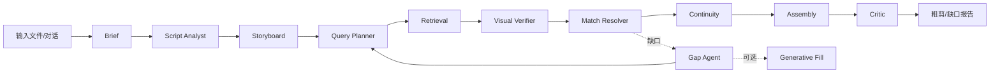

# 分镜与粗剪界面设计方案

状态：**已按审批实现本地分镜工作台（P1/P2 基础）**  
范围：分镜生成、精确匹配、对话调整、ROUGH CUT 交接  
依据：`TEMP/分镜与粗剪.svg`（只取相对位置）、现有 OpenFilm 视觉语言、VideoSeek AI 剪辑实现  
静态设计稿：`TEMP/分镜与粗剪界面设计稿.html`（浏览器打开；仅示意，无业务逻辑）  
审批问题见第 14 节。

---

## 0. 结论摘要

1. **界面仍沿用布局文件的四块结构**：顶部导航、左侧分镜/粗剪、右侧 AI 对话、底部素材库/素材篮。
2. 左侧不只是一面卡片墙，而是 **分镜板 + 节奏条** 的一体工作面；需要看整体节奏时切换为 **序列视图**。
3. 底部是 **上下文素材架**，四个页签：素材库、素材篮、候选、缺口。选中某镜后自动进入“候选”，这是精确匹配的主要操作区。
4. AI 的每次结构性修改都以 **提案（Proposal）** 出现，可预览、应用、撤销；Agent 不直接偷偷改项目。
5. 采用“一个外壳，多套 Agent 编排预设”的方向：本期重点设计 **检索验证型**（VideoSeek 血统），另外三套作为未来可切换流程。
6. 首期只用已有素材；生成补镜是**可选 Agent 模块**，生成镜头必须带来源标记，并在进入精剪时单独统计。
7. 允许带缺口/低置信镜头进入精剪；交接时明确列出缺口，不自动用错误素材填满。

---

## 1. 设计目标与边界

### 1.1 目标

- 从“脚本/一句话”到“可进入精剪的粗剪时间线”，全程在一个工作面上完成。
- 让分镜卡片同时承担四种信息：**叙事意图、画面要求、素材证据、可编辑时长**。
- 精确匹配必须可解释：用户能看到候选、来源区间、匹配理由、证据帧，而不是只看到一个分数。
- AI 是模块化的协作者，不是黑盒按钮；每个 Agent 的输入、输出、权限和失败边界清楚。
- 保持 OpenFilm 现有专业剪辑工具的密度和质感，不做成聊天机器人首页。

### 1.2 首期不做

- 不做完整的多轨精剪（进入“剪辑”阶段后再做）。
- 不做复杂节点编辑器；模块化编排先以 Agent 运行面板和内部注册表实现。
- 不默认做文生视频/图生视频；生成补镜只在配置了生成模型时出现。
- 不把模型密钥、候选临时结果写入项目文件。
- 不做自动发布、自动导出成片。

---

## 2. 页面布局

### 2.1 与 TEMP 布局文件的对应关系

```text
┌──────────────────────────────────────────────────────────────────────┐
│ 导航栏：项目名 / 1项目 2素材库 [3分镜与粗剪] 4剪辑 5音效 6交付 / 右侧操作 │
├───────────────────────────────────────────────────┬──────────────────┤
│ 分镜界面                                          │ AI 对话界面       │
│                                                   │                  │
│  工具栏：视图 / 筛选 / 统计 / 自动匹配 / 进入精剪  │ 导演 Agent        │
│  ┌ 场景 01 · 开场 ─────────────────────────────┐  │ 对话 / 运行 / 历史 │
│  │ [01 分镜卡] [02 分镜卡] [03 分镜卡] ...      │  │ 消息与提案        │
│  └─────────────────────────────────────────────┘  │ 上下文与输入框     │
│  ┌ 场景 02 · 转折 ─────────────────────────────┐  │                  │
│  │ ...                                        │  │                  │
│  └─────────────────────────────────────────────┘  │                  │
│  节奏条：00:00 ── 镜头块 ── 缺口 ── 总时长       │                  │
├───────────────────────────────────────────────────┴──────────────────┤
│ 素材架：素材库 | 素材篮 | 候选 | 缺口     搜索 / 来源范围 / 筛选        │
│ [素材卡] [素材卡] [素材卡] ...                                        │
└──────────────────────────────────────────────────────────────────────┘
```

布局文件只表达上下左右关系；实际尺寸按窗口和内容调整。建议：

| 区域 | 建议尺寸 | 行为 |
|---|---|---|
| 顶部导航 | 46–50 px | 复用现有项目标题栏和六步工作流 |
| 分镜区 | 宽度约 64%–72% | 最小 520 px；窗口变窄时 AI 面板可收起 |
| AI 面板 | 宽 360–420 px | 可拖拽，最小 320 px；可折叠为 44 px 竖条 |
| 底部素材架 | 高 148–176 px | 可拖拽，最低 96 px；折叠 36 px |
| 分镜板/序列条 | 分镜板为主，节奏条 72–96 px | 序列视图可临时覆盖分镜板 |

桌面最小窗口建议 1100×720。窗口小于 1180 px 时隐藏 AI 面板的说明文字，但保留 Agent 状态和输入框。

### 2.2 视觉层级

- 整个页面一层层“板”叠在深色画布上，继续使用现有的 `--dock-shell` / `--dock-pane` / `--surface-2`。
- 分镜卡是最大视觉单位；缩略图是主要信息，文字不抢画面。
- AI 面板不使用大面积彩色；只在 Agent 运行、提案、证据处使用细状态条。
- 主操作保持“墨色/品牌蓝”按钮；危险操作只在菜单或确认弹窗中出现。
- 时间线块沿用现有 teal/blue、缺口用低饱和 amber 斜纹；颜色之外必须有图标和文字。

---

## 3. 核心对象与状态

### 3.1 对象

```text
Storyboard
  ├─ scenes[]：场景顺序、标题、折叠状态
  └─ shots[]：分镜卡
       ├─ 叙事：标题、旁白/台词、画面意图、必须/避免
       ├─ 时间：目标时长、画幅、转场
       ├─ 匹配：候选、选中片段、置信度、证据、缺口原因
       └─ 控制：锁定、由 AI 生成、待确认
RoughCut
  ├─ shots 顺序与时长
  ├─ gaps 空白/缺镜区间
  └─ preview 总时长、节奏、连续性提示
AgentProposal
  ├─ operations[]：对分镜/匹配/顺序的受控修改
  ├─ affectedShotIds[]
  ├─ summary / risk
  └─ state：预览 → 应用 → 撤销
```

### 3.2 状态标签

| 状态 | 卡片标签 | 含义 |
|---|---|---|
| `draft` | 草稿 | AI 已生成，用户尚未确认 |
| `matching` | 匹配中 | 正在检索/审核 |
| `matched` | 已匹配 92 | 有采用片段，置信度高 |
| `review` | 待确认 | 有候选，但需要人看证据 |
| `gap` | 缺镜 | 没有合格素材或用户拒绝候选 |
| `generated` | 生成补镜 | 来自生成模型，不是库内素材 |
| `locked` | 锁 | 防止 AI/批量操作覆盖 |
| `failed` | 失败 | 任务失败，可重试 |

`locked` 是正交属性，不是独立生命周期。状态必须同时有文字/图标，不能只靠颜色。

---

## 4. 分镜界面（左侧）

### 4.1 工具栏

从左到右：

1. **标题与统计**：`分镜板`，`8 镜 · 00:36 · 2 缺口`。
2. **视图切换**：`分镜` / `序列`（分段控件，快捷键 `1` / `2`）。
3. **筛选**：全部 / 待确认 / 缺镜 / 生成；只在有内容时出现。
4. **运行状态**：Agent 正在工作时显示一个小进度条和“停止”；不打开占满页面的进度窗。
5. **右侧动作**：`自动匹配`（批量，带范围菜单）、`预览`、`进入精剪`。

`进入精剪` 是唯一高优先级按钮；有缺口时不禁用，点击后进入交接检查。生成/匹配正在运行时禁用，避免把半成品写进时间线。

### 4.2 分镜卡

```text
┌────────────────────────────────────┐
│ 03  场景 01              [待确认] 🔒│  ← 编号、场景、状态、锁定
│ ┌────────────────────────────────┐ │
│ │ 16:9 缩略图 / 视频首帧 / 缺口纹理│ │
│ │ 源 00:12.4 ─ 00:16.0     92%   │ │  ← 匹配后显示源区间与分数
│ └────────────────────────────────┘ │
│ 标题：雨夜，人物第一次回头            │
│ 旁白：他听见了不该听见的声音。         │
│ 画面：近景 · 冷色 · 手持 · 回头       │
│ [必须: 夜景] [避免: 正脸]             │
│ ────────────────────────────────── │
│ 素材：城市夜雨_03.mp4   [换一条] [证据]│
└────────────────────────────────────┘
```

卡片规则：

- **默认 1 列/2 列/3 列自适应**：宽 ≥ 720 px 两列，≥ 1080 px 三列；卡片最小 240 px。
- **点击**选中；`Ctrl/Cmd + 点击`多选；`Shift + 点击`范围选择。
- **双击标题/旁白/画面要求**进入行内编辑；自动保存；`Esc` 取消，`Ctrl+Enter` 提交。
- **时长**在卡片右上角显示；点击直接编辑秒数或 `mm:ss`；与目标时长/源片段长度冲突时给出可行动的提示。
- **锁定**阻止 AI 批量改写、自动重配和删除，但仍可手动换素材。
- **匹配后**缩略图优先显示实际源片段的首帧；hover 播放 2 秒循环预览。
- **未匹配**显示低对比纹理 + “缺镜”，不显示假缩略图。
- **生成补镜**右上角有“生成”徽标；证据抽屉显示模型、提示词和生成时间。

卡片的右上角更多菜单：复制镜头、在此后插入、拆分为两镜、合并到上一镜、删除、重新匹配、查看 Agent 记录。

### 4.3 场景组织

- 卡片按场景分组，场景标题为粘性条（sticky）；可折叠。
- 场景标题右侧显示镜头数和时长；可改名、插入镜头、折叠。
- 场景本身不强制对应时间线片段；它只组织叙事。
- 拖动卡片时显示插入线；跨场景拖动后重新编号，但保持镜头 ID 不变（Agent 引用不失效）。

### 4.4 节奏条 / 序列视图

**节奏条**（分镜视图底部常驻）：

- 宽度按镜头时长成比例；缺口用斜纹；生成镜头用细边。
- 点击/拖动定位，点击块选中对应卡片；拖动块调整顺序（同时改变粗剪顺序）。
- 显示总时长、目标时长、缺口数量；过长/过短用文字提示，不用刺眼红色。
- 适合快速看“这版是否像一支片子”，不替代精剪时间线。

**序列视图**（切换后）：

- 左侧区域变成一条可拖动的粗剪时间线；镜头块显示缩略图、序号、时长。
- 缺口以占位块存在，可点击打开候选架；不是删除。
- 顶部提供简单预览播放、总时长、目标时长差；不显示多轨和调色参数。
- 支持拖拽排序、修改镜头时长、设置简单转场；复杂操作留给“剪辑”阶段。
- 从序列视图返回分镜视图时保持选中镜头和滚动位置。

### 4.5 空状态

没有分镜时，左侧不是空白：

```text
        把想法变成第一版分镜
  [导入 MD / PDF / 纯文本]   [和 AI 从一句话开始]
  1 解析 → 2 分镜卡片 → 3 精确匹配素材 → 4 进入精剪
```

- 支持把文件拖到左侧任意位置；拖入时整块高亮。
- 底部素材架显示当前素材库是否已索引；未索引时提供“去索引”，但不阻断手动分镜。
- AI 面板预置三个问题：目标时长、画幅、语气/受众；用户可以直接说“30 秒，16:9，冷峻预告片”。

### 4.6 生成与匹配中的状态

- 新卡片逐张出现，骨架屏保留版式；不要用全屏 loading。
- 每张生成中的卡片显示 `分镜 Agent`；匹配中的卡片显示 `匹配 Agent`。
- 左侧工具栏的全局进度只显示阶段，不预估虚假剩余时间。
- 失败时保留已生成卡片，并给单镜重试；不把整页清空。

---

## 5. 底部素材架

底部四块共用一条可拖拽高度的横架：

```text
┌ 素材库 | 素材篮 | 候选：第 03 镜 | 缺口 ─────────────── [搜索] [范围] [筛选] ┐
│ [缩略图] 名称 / 时间 / 分数 / 来源                                       │
│ [缩略图] ...                                                             │
└──────────────────────────────────────────────────────────────────────────┘
```

### 5.1 四个页签

1. **素材库**：项目库/外部库的浏览，支持文件搜索、文件夹、类型筛选、排序；卡片可拖入分镜卡或素材篮。
2. **素材篮**：用户从素材库挑出的素材或镜头区间，等待分配；支持拖入某镜、批量分配、清空。
3. **候选**：只在选中某镜时出现；显示自动匹配结果，按“精确匹配 / 相似候选 / 生成补镜”分组。
4. **缺口**：所有未匹配、被拒绝的镜头；低置信镜头仍保留采用片段，在卡片上标色，可以从候选里换。

选中卡片时默认切到“候选”，但不强制：用户点“素材库”后保持该页签，直到下一次明确选择“候选”。这样不会打断手动挑素材。

### 5.2 候选卡

- 16:9 缩略图，hover 播放源区间。
- 来源文件、源入出点、时长、分数、匹配类型。
- `采用`、`预览`、`查看证据`、`换一条`。
- 证据抽屉：查询词、必须/避免条件、VL 审核帧（开始/中段/结尾）、是否因时长被裁剪。
- 同一素材的相邻候选合并显示，避免同一视频刷屏；仍可展开。
- 候选来源为生成补镜时，显示模型、提示词、生成成本，并带“生成”徽标。

### 5.3 拖放规则

- 从素材库拖到卡片：分配为候选/直接采用；按住 `Alt` 只加入素材篮。
- 从候选拖到卡片：采用该源区间。
- 从卡片拖到素材篮：把该镜当前选中的素材区间放入篮子（用于复用/备用）。
- 从素材篮拖到卡片：批量分配；多镜选中时按顺序分配。
- 拖到缺口占位块：把该素材作为缺口的补齐候选。
- 所有拖放都显示明确 drop 目标；非法目标显示禁止光标和原因。

---

## 6. AI 对话面板（右侧）

### 6.1 结构

```text
┌────────────────────────────────────────┐
│ 导演 Agent    [上下文: 选中 2 镜]  [⋯] │
│ 对话 | 运行 | 历史                      │
├────────────────────────────────────────┤
│ 消息、分镜变更说明、提案、证据           │
│                                        │
│ ┌ 提案：压缩节奏到 30 秒 ─────────────┐ │
│ │ 影响 5 镜 · 预计减少 6.2 秒          │ │
│ │ [预览变更] [应用] [撤销]             │ │
│ └──────────────────────────────────────┘ │
├────────────────────────────────────────┤
│ 上下文 chips: 全片 / 选中 / 场景 01     │
│ [输入一句话，或按 / 选择动作...]   [↑] │
└────────────────────────────────────────┘
```

### 6.2 三个页签

- **对话**：用户与 Agent 的编辑对话；结果以提案和简短说明呈现。
- **运行**：当前/最近 Agent 运行；模块、步骤、工具、耗时、失败原因、取消/重试。
- **历史**：所有已应用变更，与应用者（用户/AI）、时间、影响镜头；可直接撤销。

### 6.3 Agent 状态与模块可见性

面板顶部显示当前编排预设：

- `检索验证`（默认）：Storyboard → Match → Verify → Continuity → Assembly。
- `时间线代理`：在精剪阶段显示。
- `文本驱动`、`生成分镜`：未来预设。

点击 `⋯` 打开 **Agent 运行面板**：

- 每个模块一行：名称、角色（LLM/VL/检索/确定性）、状态、输入/输出 artifact、耗时、成本。
- 失败模块可以单独重试；不允许在这里绕过权限直接改项目。
- 未来可进入“编排”模式拖动模块、验证依赖、保存为项目预设；首期只读展示，避免把主界面做成节点画布。

### 6.4 上下文规则

- 默认上下文：整个分镜。
- 选中镜头后，chips 出现 `选中 2 镜`；用户可切换为 `只看选中`。
- 场景视图选中时显示场景 chip；底部候选页签选中时显示 `候选上下文`。
- Agent 发送前的上下文摘要可见，不允许“以为它看的是全片，其实只看了一镜”。
- 锁定镜头默认不进入自动修改；若用户要求，必须明确提示“有 1 个锁定镜头将被跳过”。

### 6.5 提案模式

所有结构性修改都生成 `AgentProposal`：

- 摘要：改了什么、影响哪些镜头、是否改变总时长、风险。
- 预览：在分镜板上高亮新增/修改/删除；用差异色和图标，不只改文字。
- 应用：一次项目历史操作；可在历史中整体撤销。
- 拒绝：保留对话，卡片不变。
- 低风险操作（如仅补齐空白、添加字幕占位）可由用户预设自动应用；默认不自动应用。

典型提案：
- “把第 04 镜换成更压迫的近景”
- “整体压到 30 秒，保留开头三镜”
- “找出所有重复使用同一素材的镜头，给我替代候选”
- “把旁白拆成两句，第二句留给环境声”

### 6.6 快捷动作

上下文相关，不做固定营销入口：

- `补齐所有缺镜`
- `重新匹配待确认`
- `压缩到目标时长`
- `统一镜头节奏`
- `减少素材复用`
- `把选中的镜头改成…`

快捷动作只把意图写入输入框，不直接执行。

---

## 7. 完整用户流程与交互

### 7.1 从文件开始

1. 进入“分镜与粗剪”，左侧空状态；拖入 MD/PDF/纯文本或点击导入。
2. 解析预览：场景数、镜头数、语言、警告、解析出的角色/地点；用户确认后才写入分镜。
3. `分镜 Agent` 生成卡片；右侧“运行”显示解析、分镜、结构校验。
4. 生成完成后进入 `草案`；精确匹配由用户点击“匹配/匹配选中”触发，不在后台自动开始。
5. 匹配结果逐卡出现；选中一镜，底部自动到“候选”；高低置信均采用，低置信同时显示置信度和橙黄/红色标记，用户可随时换候选。
6. 用户修改文案/画面要求/时长；改动过的镜头标记待重新匹配，用户可单镜重跑，也可批量。
7. 用户对 AI 说“把第三镜换成更紧张的镜头，整体压到 30 秒”；Agent 产出提案；预览后应用。
8. 切到“序列”检查节奏和缺口；拖动调整顺序。
9. `进入精剪`：交接检查，允许保留缺口；生成可编辑粗剪时间线，本阶段完成。

### 7.2 从一句话开始

1. 右侧输入“30 秒预告片，冷峻、雨夜、不要出现人脸”。
2. Agent 先回一个简短的 **Brief 确认**（时长、画幅、语气、约束），不立刻生成。
3. 用户确认或补充；分镜 Agent 生成 6–10 镜。
4. 之后与 7.1 第 4 步相同。

### 7.3 手动调整

- 直接改卡片字段，自动保存；不需要“应用 AI”。
- 拖动卡片调整顺序；拖动节奏条改变粗剪顺序。
- 从素材架拖素材/候选到卡片；按住 `Alt` 加入篮子。
- 锁定镜头，避免后续批量 AI 操作覆盖。
- 拆分/合并镜头；删除时若被锁定则先提示解锁。
- 所有手动操作进入项目撤销历史。

### 7.4 精确匹配

1. 选中卡片 → 底部“候选”出现。
2. 候选分三组：精确匹配、相似候选、生成补镜。
3. 点开“证据”：查询词、必须/避免条件、3 帧 VL 审核、时长裁剪理由。
4. `采用` 或拖入卡片；`换一条` 重新请求；`固定` 防止自动替换。
5. 没有候选时卡片进入“缺镜”；缺口页签可按“重新匹配 / 写得更具体 / 生成补镜 / 保留空白”处理。
6. 批量匹配只处理未锁定镜头；运行前显示范围和预计镜数。

### 7.5 进入精剪交接

点击“进入精剪”打开检查表：

```text
分镜 8 · 时长 00:36 · 目标 00:30
已匹配 6 · 待确认 1 · 缺镜 1 · 生成补镜 0

[ ] 保留缺口占位（默认勾选）
[ ] 同时创建字幕草稿
[ ] 同时创建配音草稿（未配置 TTS 时禁用）

[取消]                         [生成粗剪并进入精剪]
```

- 缺口允许进入；交接后时间线保留空白占位和报告。
- 低置信镜头保留“已采用 + 低置信”标记和醒目颜色，精剪阶段仍可看到。
- 生成后本阶段不自动锁定；可在精剪中返回检查，但需提示“精剪已修改，返回分镜可能覆盖粗剪顺序”。

---

## 8. Agent 模块化设计

### 8.1 原则

1. **Agent 只产出 artifact 或 proposal，不直接写项目。**
2. **所有项目写入经过 Patch Gateway**，有 baseVersion、权限检查和撤销记录。
3. **模块以 artifact 依赖装配**，不是按界面按钮拼流程。
4. **失败隔离到镜头**，一个镜头失败不阻断整片。
5. **确定性工具优先**：时长裁剪、去重、排序、连续性优化不交给 LLM 随意决定。
6. **可解释**：每个采用决定都有查询、候选、证据和理由。

### 8.2 模块接口（设计契约）

```ts
interface AgentModule<In, Out> {
  id: string
  version: string
  role: 'llm' | 'vl' | 'retrieval' | 'deterministic' | 'assembly'
  requires: ArtifactKind[]
  provides: ArtifactKind[]
  permissions: ('read' | 'propose' | 'search' | 'generate')[]
  run(ctx: AgentContext, input: In): AsyncIterable<AgentEvent<Out>>
}

type AgentEvent =
  | { type: 'progress'; step: string; percent?: number }
  | { type: 'artifact'; artifact: Artifact }
  | { type: 'proposal'; proposal: AgentProposal }
  | { type: 'issue'; issue: AgentIssue }
```

编排器负责：

- 校验依赖（`requires` 必须在 `provides` 之前）。
- 并行化可并行镜头。
- 把失败转成 `AgentIssue` / `gap`，不中断整片。
- 提供预算（调用数、token、生成秒数）和取消。
- 生成运行快照，保证可复现。

### 8.3 建议模块

| 模块 | 输入 | 输出 | 责任 |
|---|---|---|---|
| Brief Agent | 文件/对话 | Brief、约束 | 解析目标、受众、时长、画幅、语气、禁忌 |
| Script Analyst | Brief/原文 | 场景、节拍、旁白 | 保留原文顺序；不擅自改事实 |
| Storyboard Agent | Brief/场景 | StoryboardDraft | 生成镜头卡、画面意图、必须/避免 |
| Query Planner | Shot | QueryPlan | 1–3 条检索词、硬条件、负条件、时长范围 |
| Retrieval Agent | QueryPlan/素材索引 | CandidateSet | 向量检索、时间窗口、去重、来源多样性 |
| Visual Verifier | CandidateSet | Verification | 抽帧 VL 审核，给出通过/不确定/失败及理由 |
| Match Resolver | CandidateSet/Verification | MatchDecision | 选片段、裁剪到目标时长、标记低置信 |
| Continuity Agent | 全片 MatchDecision | ContinuityReport | 重复、景别/运镜连续性、节奏、时长 |
| Gap Agent | 缺口 | FixProposal | 改查询、重搜、建议改写、生成补镜或保留空白 |
| Assembly Agent | 已确认镜头 | RoughCutDraft | 生成粗剪顺序、缺口、转场占位 |
| Critic Agent | RoughCutDraft | IssueList | 检查目标时长、约束、证据完整性 |
| Director Agent | 用户对话 | Proposal | 把自然语言变成受控 patch，不直接改素材 |

生成补镜是可选模块：`GenerativeFillAgent` 读取缺口镜头和参考帧，产出带模型/提示词/成本的生成候选，仍须经过用户确认或明确自动规则。

### 8.4 默认编排（检索验证型）



- 单镜检索/审核可并行；连续性优化必须等全片匹配结果。
- 高低置信结果都采用；低置信保留置信度和橙黄/红色标记，用户可换候选；没有合格候选进入“缺镜”。
- `Gap Agent` 最多按预算重搜；耗尽后保留空白，不伪造。

### 8.5 权限与审批

| 动作 | Agent | 用户 |
|---|---|---|
| 读取素材/时间线 | 允许 | 允许 |
| 生成草案/候选 | 允许 | 允许 |
| 应用草稿 | 需提案/审批 | 直接 |
| 删除/锁定 | 不允许 | 允许 |
| 进入精剪 | 仅建议 | 确认 |
| 生成补镜 | 需配置+预算 | 确认/可自动规则 |

### 8.6 模块化在界面中的呈现

- 主界面只显示“当前 Agent / 运行状态 / 提案”，不显示完整节点画布。
- “运行”页签按模块列出本次运行，可查看输入输出摘要。
- 高级“编排”面板（后续）允许：
  - 拖入/移除模块；
  - 自动校验 `requires/provides`；
  - 保存为项目预设；
  - 设置自动应用阈值、预算、模型绑定。
- 模块失败不隐藏：在卡片上留下“未完成”原因，在运行面板中可重试。

---

## 9. 四版 AI 剪辑流程对比

> 这一节只做方案对比，不要求本期实现四套。四套共享同一套 artifact 和 Agent 协议，差别在编排顺序、启动状态和写回方式。

### 9.1 R1 检索验证型（VideoSeek 血统，推荐默认）

**流程**

```text
脚本/对话 → 分镜/Beat → 查询计划 → 素材检索 → 候选时间窗
→ 抽帧 VL 审核 → 选片段/裁剪 → 全片节奏与连续性优化
→ 配音/字幕（可选）→ 粗剪 → 缺口报告
```

**特点**

- 以已有素材为中心，强调“找到并证明这段画面合适”。
- 每个镜头可有多个候选；VL 审核失败会改写查询重搜。
- 确定性风格权重和全局选镜可以优化节奏、景别、运镜、复用。
- 没素材时保留缺口，不伪造完成。

**参考**

- 本地 VideoSeek：`src/workflows/ai_editing.py`、`services/agentic_edit_service.py`、`docs/ai-editing.md`、`docs/agentic-editing.md`
- `poseljacob/agentic-video-editor`：多 agent、命令行、确定性剪辑工具
- 论文：Prompt-Driven Agentic Video Editing System（arXiv 2509.16811）

**适合 OpenFilm 首期**

- 已有项目素材、外部素材库、本地 CLIP 向量搜索已经存在。
- 与“精确匹配素材”目标完全一致。
- 风险是素材不足/索引质量；用缺镜和证据解释处理。

### 9.2 R2 时间线代理型（Timeline Agent）

**流程**

```text
已有时间线/素材 → Agent 读取选中区间与工程上下文
→ 规划工具调用（分割/裁剪/波纹/转场/字幕/标记）
→ 以可撤销操作组执行 → 用户在时间线上复核
```

**特点**

- 不先做分镜卡片，而是直接理解“当前时间线 + 用户意图”。
- 适合已经进入剪辑、需要批量整理、粗剪、找 B-roll、做版本的场景。
- 关键是**原生工具调用**和**完整撤销/历史**；Agent 不应直接改不可编辑的成片。
- 参考 Adobe Premiere Pro AI Assistant 2026 public beta：在真实工程内编排项目整理、素材标记、stringout/rough assembly，输出可编辑 sequence，所有动作进入 undo/history。
- 也可参考 Agentic-Video-Editor 的确定性剪辑工具层。

**适合 OpenFilm**

- 更适合放在“剪辑”阶段或第二阶段；分镜阶段只预留接口。
- 若首期直接做，会和现有编辑器复杂度叠加，不建议。

### 9.3 R3 文本驱动型（Transcript-first）

**流程**

```text
素材 → 转写/对齐 → 文本成为主编辑面
→ 删词/改句/重排 → 视频、字幕、时间线同步变化
→ Underlord 风格 Agent 批量清理口头禅、停顿、重拍、加 B-roll
```

**特点**

- 编辑对象是文字，不是镜头卡；视频是文本的投影。
- 非常适合访谈、播客、口播、课程；对“写脚本→生成画面”型片子不适用。
- 需要可靠转写、词级时间对齐、长音频处理。
- 参考 Descript Underlord / text-based editing；其 Agent 支持多步编辑、场景、字幕、音色、MCP/API。

**适合 OpenFilm**

- 可作为后续“文本/访谈项目”预设，和现有字幕轨、转写能力结合。
- 不适合作为本项目分镜粗剪的主流程。

### 9.4 R4 生成分镜型（Generative Storyboard）

**流程**

```text
Brief/脚本 → 场景/镜头拆分 → 角色/场景/风格元素
→ 每个镜头生成关键帧 → 生成视频片段 → Animatic
→ 时间线编排 → 审核/重生成
```

**特点**

- 不从素材库找镜头，而是生成镜头；一致性来自角色/风格元素和参考图。
- 分镜卡片即是“生成板”：一张卡对应一个镜头、提示词、参考图和生成版本。
- 成本高、迭代慢、连续性难；需要更强的版本管理和审核。
- 参考 LTX Studio：Script → Storyboard → 多模型视频生成 → 音频 → 时间线；Adobe Firefly：storyboard to video。Adobe Premiere 2026 也支持在时间线中用生成模型补镜。

**适合 OpenFilm**

- 作为 R1 的**可选补镜模块**，只在缺口、且用户配置了生成模型时出现。
- 不作为默认主流程；生成镜头单独标记，进入精剪时统计。

### 9.5 对比与建议

| 维度 | R1 检索验证 | R2 时间线代理 | R3 文本驱动 | R4 生成分镜 |
|---|---|---|---|---|
| 起点 | 脚本/对话/分镜 | 已有时间线 | 已有口播/访谈 | Brief/脚本 |
| 编辑单位 | 分镜卡 + 素材片段 | 时间线操作 | 词/句/段落 | 生成镜头 |
| 核心循环 | 检索 → 审核 → 组装 | 读上下文 → 工具调用 → 复核 | 改文本 → 画面同步 | 生成 → 选版 → 重生成 |
| 优势 | 可控、可解释、复用素材 | 精确、贴近专业剪辑 | 快速处理长口播 | 无素材也能成片 |
| 风险 | 素材/索引不足 | 工具权限与撤销复杂 | 依赖转写质量 | 成本、连续性、版权 |
| OpenFilm 定位 | **首期默认** | 剪辑阶段后续 | 访谈/口播预设 | 可选补镜/未来 |

**推荐**：首期只实现 R1 的界面与 Agent 骨架；R4 以“生成补镜”单模块预留；R2/R3 作为未来预设，不进入本期代码范围。四套流程共用本文的 artifact、Proposal、撤销和 Agent 运行面板。

---

## 10. 数据与持久化建议

> 仅设计，不是实现承诺。

- `.film/storyboard.json`：当前分镜文档（scenes、shots、match 决策、版本号）。
- `.film/storyboard/history/`：分镜/匹配变更快照，沿用项目历史策略。
- `.film/storyboard/evidence/`：可选证据帧缓存；可重建，不进入备份必需项。
- 候选临时结果不进入项目，除非被采用；采用后才写入 shot.match。
- 进入精剪后，RoughCut 写入正式项目时间线；保留 storyboard 版本引用。
- Agent run 记录独立于项目内容，但保存输入/输出摘要和成本；密钥不写入。

概念接口：

```text
GET  /api/projects/:id/storyboard
POST /api/projects/:id/storyboard/generate
POST /api/projects/:id/storyboard/match
POST /api/projects/:id/storyboard/proposals/:proposalId/apply
POST /api/projects/:id/storyboard/handoff
GET  /api/projects/:id/storyboard/events       (SSE)
```

---

## 11. 交互规则汇总

### 11.1 选择与编辑

- 单击选卡；`Ctrl/Cmd` 多选；`Shift` 范围选择；空白处取消。
- 双击文本行内编辑；自动保存；`Esc` 取消。
- `Space` 预览选中镜头；`Enter` 打开候选；`Delete` 删除（锁定则提示）。
- `Ctrl/Cmd + Z` / `Shift + Ctrl/Cmd + Z`：项目级撤销/重做。
- `1` / `2`：分镜/序列视图；`/` 聚焦素材搜索。
- 拖拽卡片有插入线；按住 `Alt` 复制而非移动。

### 11.2 Agent 运行

- 同一项目同一时间只允许一个写操作型 Agent run；只读检索可并行。
- 用户修改镜头后，正在跑的匹配结果若基于旧版本，标记 `stale`，不自动覆盖。
- 取消后保留已提交的候选和卡片；显示“已停止，已完成部分保留”。
- 失败按镜头显示；批量任务不因一镜失败全红。

### 11.3 自动/手动边界

- 默认由用户触发：生成分镜、开始匹配、生成补镜都由用户点击；不在后台自动生成。
- 默认采用：匹配结果高/低置信均采用；低置信必须显示置信度和醒目颜色，方便用户换候选。
- 默认需确认：生成补镜、批量删除/合并、进入精剪。
- 锁定镜头永不自动改写。
- AI 不得更改用户原文事实；只能提出改写建议，除用户明确要求。
- “精确匹配”不等于“自动采用”；低置信必须可见。

### 11.4 一致性

- 任何影响顺序/时长的操作，同时更新节奏条和粗剪草稿。
- 任何改文案/画面要求的操作，清空该镜旧候选并标记待重配（锁定镜除外）。
- 任何应用/撤销都更新历史面板；Agent 提案是一整个历史步骤。
- 进入精剪后，分镜与时间线建立版本关联；从精剪返回分镜时提示覆盖风险。

---

## 12. 空态、错误与可访问性

- **无模型**：AI 面板显示“未连接模型”，提供设置入口；分镜仍可手动创建；匹配仍可用本地索引。
- **无索引/索引失败**：底部素材架显示索引状态和“建立索引”，精确匹配禁用但素材库浏览可用。
- **解析失败**：保留原文件，显示失败位置和“改为纯文本”；不写入半成品。
- **无候选**：卡片缺口；可改要求重搜、换素材、生成补镜或保留空白。
- **服务离线/超时**：Agent 运行失败卡片；重试不重复已采用的片段。
- **长列表**：卡片与素材架按需渲染；搜索防抖；批量操作显示范围。
- **键盘可达**：所有卡片操作可通过焦点和快捷键完成；拖拽有非拖拽替代（菜单“分配到…”）。
- **颜色不是唯一信息**：状态有文字和图标；缺口有斜纹；生成有徽标。
- **屏幕阅读器**：卡片读作“第3镜，待确认，已匹配 92%”；运行状态用 `aria-live=polite`。

---

## 13. 后续实现阶段（审批通过后）

1. **P1 壳与数据**：分镜文档、卡片、场景、底部四页签、状态与撤销。
2. **P2 检索验证**：复用现有语义搜索；查询计划、候选、证据、单镜/批量匹配。
3. **P3 对话提案**：Director Agent 输出受控 patch；预览/应用/撤销；运行面板。
4. **P4 粗剪交接**：节奏条/序列视图；缺口；进入精剪；时间线生成。
5. **P5 可选生成补镜**：独立模块、配置门控、成本/版权提示。
6. **以后**：R2 时间线代理、R3 文本驱动预设、Agent 编排面板。

每一阶段都应先做可运行的静态状态和键盘/空态，再接入模型，避免“按钮存在但流程不通”。

---

## 14. 请审批的点

1. **默认流程**：首期按 R1（VideoSeek 式检索验证）设计，R4 只作为可选生成补镜，R2/R3 暂不实现，是否同意？
2. **左侧形态**：分镜板为主 + 底部常驻节奏条；另提供“序列”视图；不把整个粗剪做成完整多轨时间线，是否同意？
3. **底部素材架**：四页签（素材库/素材篮/候选/缺口），选中镜头自动切候选，默认高度约 160 px 且可调整，是否同意？
4. **匹配与生成**：生成分镜、精确匹配、生成补镜都由用户点击触发；高低置信均采用，低置信用橙黄/红色标出，是否同意？
5. **交接**：允许带缺口进入精剪并生成空白占位，是否按第 7.5 节执行？

以上确认后，再进入代码实现；本轮只交付设计与流程。

---

## 15. 参考项目

- **VideoSeek（本地）**：`D:\Tools\VideoSeek`  
  `src/workflows/ai_editing.py`、`services/agentic_edit_service.py`、`docs/ai-editing.md`、`docs/agentic-editing.md`  
  关键参考：脚本→分镜→检索→VL 审核→TTS→装配；风格权重、二阶 Viterbi、修复循环、缺口报告。
- **Agentic-Video-Editor**：<https://github.com/poseljacob/agentic-video-editor>  
  多 agent、命令行、确定性剪辑工具与从粗剪到成片的编排。
- **Descript Underlord / text-based editing**：<https://www.descript.com/underlord>  
  文本即时间线，Agent 根据对话执行剪辑；适合 R3。
- **Adobe Premiere Pro AI Assistant（2026 public beta）**：  
  <https://community.adobe.com/announcements-727/meet-your-new-assistant-editor-ai-assistant-in-premiere-pro-is-now-in-public-beta-1629317>  
  在真实工程内做项目整理、标记与 rough assembly，输出可编辑 sequence，动作进入 undo/history；适合 R2。
- **LTX Studio**：<https://ltx.io/blog/ai-video-workflow>、<https://ltx.io/blog/how-to-storyboard>  
  脚本→分镜→多模型视频生成→音频→时间线；适合 R4。
- **Adobe Firefly storyboard to video**：  
  <https://blog.adobe.com/en/publish/2026/06/18/more-time-spend-on-your-craft-adobe-brings-power-creative-agent-creative-cloud-apps>  
  参考生成分镜到视频的产品路径。
